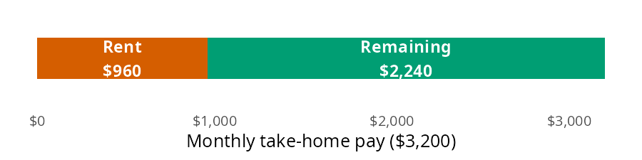
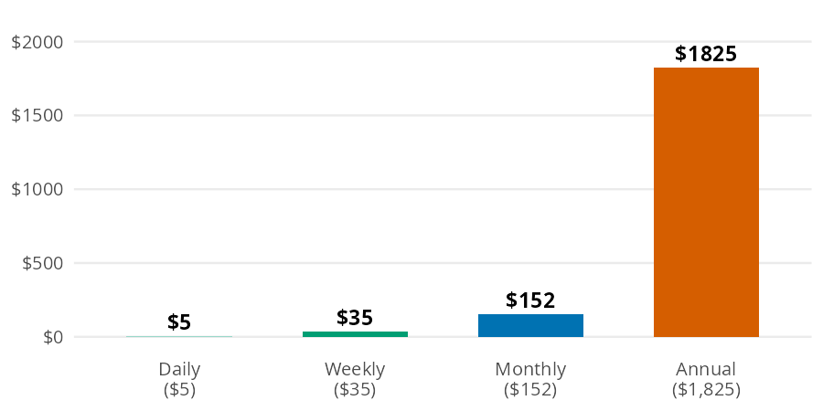
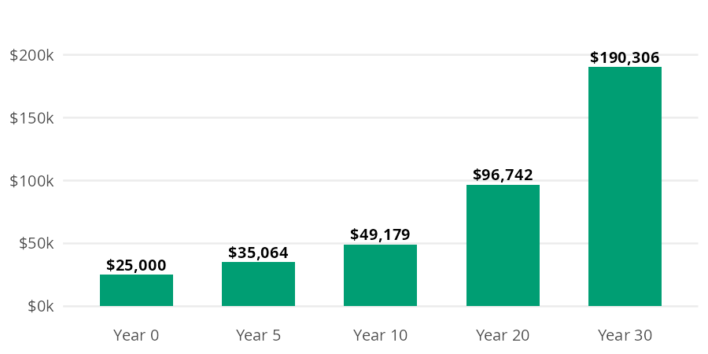
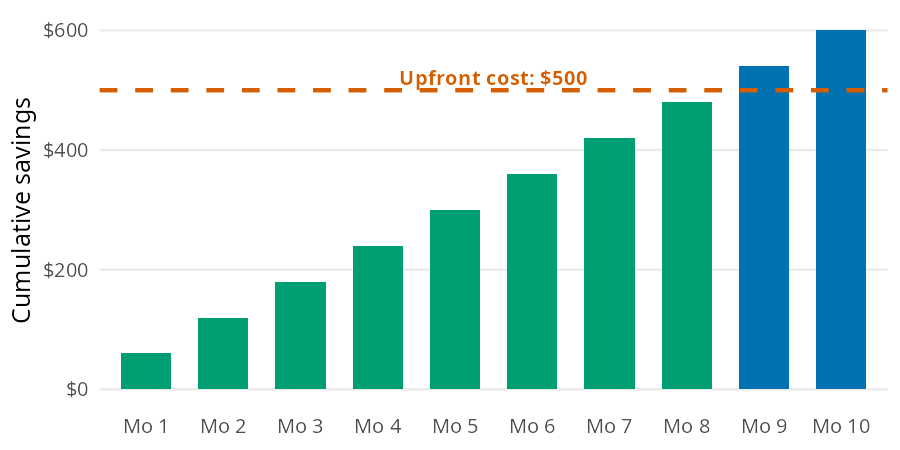

# Budgeting

Most budgeting decisions come down to a handful of small calculations. You need to know how big a slice of your paycheck an expense takes and what a daily habit costs over a year. You also need to know what money spent today could have grown into, and how long an upfront purchase takes to pay for itself. The [Budgeting](https://mjfrigaard.github.io/fm-finance/budgeting.html) chapter of the book builds each of these from scratch. In this page I'll answer the same questions with [percent_of_income()](../reference/percent_of_income.md#perfinpy.percent_of_income), [to_annual()](../reference/to_annual.md#perfinpy.to_annual), [to_monthly()](../reference/to_monthly.md#perfinpy.to_monthly), [opportunity_cost()](../reference/opportunity_cost.md#perfinpy.opportunity_cost), and [months_to_break_even()](../reference/months_to_break_even.md#perfinpy.months_to_break_even), using the chapter's numbers so you can check every result against the book.


# The budgeting functions

All five functions accept arrays, and they follow the conventions in [Get started](get-started.md): rates go in as decimals and ratios come out as percents.

| Function | Returns | Units |
|----|----|----|
| [percent_of_income()](../reference/percent_of_income.md#perfinpy.percent_of_income) | an expense as a share of income | percent (`30` is 30%) |
| [to_annual()](../reference/to_annual.md#perfinpy.to_annual) | a daily, weekly, or monthly amount per year | dollars per year |
| [to_monthly()](../reference/to_monthly.md#perfinpy.to_monthly) | a daily, weekly, or annual amount per month | dollars per month |
| [opportunity_cost()](../reference/opportunity_cost.md#perfinpy.opportunity_cost) | what an amount could grow to if invested | dollars (`rate` is a decimal) |
| [months_to_break_even()](../reference/months_to_break_even.md#perfinpy.months_to_break_even) | months until savings cover an upfront cost | months, not rounded |


# What share of income does an expense take?

The chapter's first job example takes home \$3,200 a month and pays \$960 in rent. The question is how much of that paycheck rent claims.

Think of the monthly take home pay as a single bar. Rent is one slice of it, and the rest of the bar is what's left for everything else:


<figure class="figure">
<p></p>
<figcaption>Rent ($960) as a share of $3,200 take home pay</figcaption>
</figure>


[percent_of_income()](../reference/percent_of_income.md#perfinpy.percent_of_income) divides the width of the slice by the width of the whole bar, then multiplies by 100:


``` python
rent_share = percent_of_income(expense=960, income=3200)
rent_share
```


    30.0


Rent takes 30% of take home pay. The result is a percent, not a decimal, so `30` means 30% (see the conventions table in [Get started](get-started.md)). The expense and the income need to cover the same period. A monthly rent against a yearly salary gives a share that is off by a factor of 12.


# What does a small habit cost over a year?

A \$5 daily coffee doesn't feel expensive, because you only ever pay \$5 at a time. The same habit looks very different at longer time scales:


<figure class="figure">
<p></p>
<figcaption>The same $5 a day habit across four time periods</figcaption>
</figure>


Each bar is the one before it scaled by the number of periods it contains. [to_annual()](../reference/to_annual.md#perfinpy.to_annual) makes the daily to yearly jump in one step:


``` python
coffee_year = to_annual(amount=5, period="daily")
coffee_year
```


    1825.0


The coffee habit costs \$1,825 a year. Suddenly it's a real number you can evaluate.


## Most budgets work in months

[to_monthly()](../reference/to_monthly.md#perfinpy.to_monthly) goes in the other direction. It converts a daily, weekly, or annual amount to a monthly one, which is the unit most budgets use. Here is the coffee habit per month:


``` python
coffee_month = to_monthly(amount=5, period="daily")
coffee_month
```


    152.20000000000002


Coffee runs \$152.20 a month, which matches the monthly bar above. The chapter's second example converts \$150 a week in groceries to a monthly amount:


``` python
groceries_month = to_monthly(amount=150, period="weekly")
groceries_month
```


    649.5


Groceries come to \$649.50 a month. That is more than four weeks' worth, because a month holds about 4.33 weeks.


# What could the money have become?

The chapter frames opportunity cost with a car. Buying a used one for \$15,000 instead of a new one for \$40,000 frees up \$25,000, which the chapter invests at 7% a year. Every dollar spent isn't just that dollar; it's what that dollar could have become.


<figure class="figure">
<p></p>
<figcaption>$25,000 invested at 7%: value at each checkpoint</figcaption>
</figure>


Each year multiplies the previous bar by 1.07. [opportunity_cost()](../reference/opportunity_cost.md#perfinpy.opportunity_cost) compounds the amount over the full horizon, with the rate as a decimal:


``` python
car_gap = opportunity_cost(amount=25000, rate=0.07, years=30)
car_gap
```


    190306.37606655105


After 30 years, the \$25,000 gap grows to about \$190,306. That's not a car payment difference; that's a retirement chapter.


# When does an upfront cost pay for itself?

Some purchases cost money now to save money later: a membership, a better phone plan, or a used bike for commuting. The chapter's example is a \$500 membership that saves \$60 a month.


<figure class="figure">
<p></p>
<figcaption>$60 a month in savings accumulating toward a $500 upfront cost</figcaption>
</figure>


Each month the cumulative savings bar grows by \$60, and break even is the first month that bar crosses the \$500 line. [months_to_break_even()](../reference/months_to_break_even.md#perfinpy.months_to_break_even) divides the upfront cost by the monthly savings:


``` python
import math

be_months = months_to_break_even(upfront_cost=500, monthly_savings=60)
be_months
```


    8.333333333333334


The membership pays for itself after 8.3 months. The result isn't rounded. Use `math.ceil()` to find the first whole month you come out ahead: month 9, the first bar above the line in the bar model. If you'll keep the membership longer than that, it's worth the upfront cost.


# Variations

Array inputs let one call answer several versions of the same question. The chapter's periodic expenses are a good example. Setting aside one twelfth of each annual cost every month builds a sinking fund (money saved each month for a known future expense). [to_monthly()](../reference/to_monthly.md#perfinpy.to_monthly) converts every expense at once:


``` python
sinking = pl.DataFrame({
    "expense": ["car insurance", "gifts", "car maintenance", "vacation"],
    "annual": [1200, 600, 1200, 2400],
})
sinking = sinking.with_columns(
    monthly=to_monthly(amount=sinking["annual"].to_numpy(), period="annual")
)
sinking
```


shape: (4, 3)

| expense           | annual | monthly |
|-------------------|--------|---------|
| str               | i64    | f64     |
| "car insurance"   | 1200   | 100.0   |
| "gifts"           | 600    | 50.0    |
| "car maintenance" | 1200   | 100.0   |
| "vacation"        | 2400   | 200.0   |


Together these periodic expenses need \$450 a month. When a bill arrives, the money is already there.


## One call compares every time horizon

The same approach works for time horizons. Passing several values to `years` reproduces each checkpoint in the car bar model:


``` python
horizons = [0, 5, 10, 20, 30]
pl.DataFrame({
    "years": horizons,
    "value": opportunity_cost(amount=25000, rate=0.07, years=horizons),
})
```


shape: (5, 2)

| years | value         |
|-------|---------------|
| i64   | f64           |
| 0     | 25000.0       |
| 5     | 35063.793268  |
| 10    | 49178.783932  |
| 20    | 96742.111562  |
| 30    | 190306.376067 |


> **Warning: Limits**
>
> [to_monthly()](../reference/to_monthly.md#perfinpy.to_monthly) uses rounded factors (30.44 days and 4.33 weeks per month), while [to_annual()](../reference/to_annual.md#perfinpy.to_annual) uses 365 days and 52 weeks per year. A round trip through both functions drifts slightly. The weekly grocery bill gives a different yearly total depending on the path:
>
> <div id="cell-round-trip" class="cell" execution_count="10">
>
> ``` python
> (
>     to_annual(amount=150, period="weekly"),
>     to_annual(amount=groceries_month, period="monthly"),
> )
> ```
>
> <div id="round-trip" class="cell-output cell-output-display" execution_count="10">
>
>     (7800.0, 7794.0)
>
> <div id="putting-it-together" class="section level1">
>
> # Putting it together
>
> Back to the \$3,200 first job budget. The sections above produced four monthly costs: rent, groceries, coffee, and sinking funds. [percent_of_income()](../reference/percent_of_income.md#perfinpy.percent_of_income) takes the whole column at once, so one call shows how much of the paycheck each category claims:
>
> <div id="cell-budget" class="cell" execution_count="11">
>
> ``` python
> budget = pl.DataFrame({
>     "category": ["rent", "groceries", "coffee", "sinking funds"],
>     "monthly": [960.0, groceries_month, coffee_month, sinking["monthly"].sum()],
> })
> budget = budget.with_columns(
>     percent=percent_of_income(expense=budget["monthly"].to_numpy(), income=3200).round(1)
> )
> budget
> ```
>
> <div id="budget" class="cell-output cell-output-display" execution_count="11">
>
> <div>
>
> shape: (4, 3)
>
> | category        | monthly | percent |
> |-----------------|---------|---------|
> | str             | f64     | f64     |
> | "rent"          | 960.0   | 30.0    |
> | "groceries"     | 649.5   | 20.3    |
> | "coffee"        | 152.2   | 4.8     |
> | "sinking funds" | 450.0   | 14.1    |
>
> </div>
>
> </div>
>
> </div>
>
> These four categories take 69.1% of take home pay, which leaves \$988.30 a month for investments, savings, and fun money.
>
> Coffee is the smallest line in the budget, but it's also the easiest to change. The code below invests one year of coffee money at 7% for 30 years instead:
>
> <div id="cell-coffee-invested" class="cell" execution_count="13">
>
> ``` python
> coffee_invested = opportunity_cost(amount=coffee_year, rate=0.07, years=30)
> coffee_invested
> ```
>
> <div id="coffee-invested" class="cell-output cell-output-display" execution_count="13">
>
>     13892.365452858226
>
> </div>
>
> </div>
>
> One year of \$5 coffees could grow to about \$13,892. That doesn't mean you should give up coffee; it means the choice now has a price you can see. The [Tracking Spending](tracking-spending.md) page applies the same idea to recurring costs with [subscription_opportunity_cost()](../reference/subscription_opportunity_cost.md#perfinpy.subscription_opportunity_cost).
>
> <div id="recap" class="section level1">
>
> # Recap
>
> Budgeting math is middle school math, and these five functions cover the calculations the chapter relies on most. [percent_of_income()](../reference/percent_of_income.md#perfinpy.percent_of_income) shows how big a slice each expense takes, [to_annual()](../reference/to_annual.md#perfinpy.to_annual) and [to_monthly()](../reference/to_monthly.md#perfinpy.to_monthly) put costs on the same time scale, and [opportunity_cost()](../reference/opportunity_cost.md#perfinpy.opportunity_cost) and [months_to_break_even()](../reference/months_to_break_even.md#perfinpy.months_to_break_even) put a price on spending decisions. Because each one accepts arrays, a single call can compare a whole budget, a list of periodic expenses, or several time horizons.
>
> - [Budgeting](https://mjfrigaard.github.io/fm-finance/budgeting.html) in Personal Finance: a field manual
> - Reference: [percent_of_income()](../reference/percent_of_income.md#perfinpy.percent_of_income), [to_annual()](../reference/to_annual.md#perfinpy.to_annual), [to_monthly()](../reference/to_monthly.md#perfinpy.to_monthly), [opportunity_cost()](../reference/opportunity_cost.md#perfinpy.opportunity_cost), [months_to_break_even()](../reference/months_to_break_even.md#perfinpy.months_to_break_even)
> - Next: [Managing Debt](managing-debt.md)
>
> </div>
>
> </div>
>
> </div>
>
> </div>
