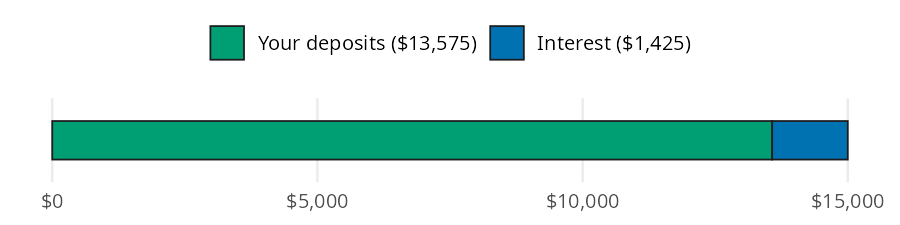
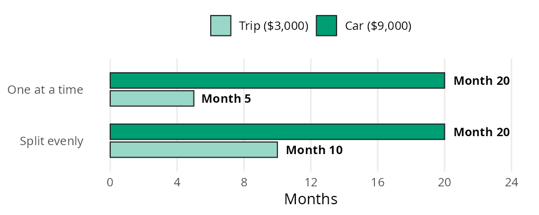

# Financial Goals

A goal without a number and a date is a wish. Once you have both, two questions are left: how much do you set aside each month, and which goal do you fund first when you can't fund them all? In this page I'll answer both with [monthly_for_goal()](../reference/monthly_for_goal.md#perfinpy.monthly_for_goal) and [months_to_fund()](../reference/months_to_fund.md#perfinpy.months_to_fund), using the numbers from the [Financial Goals](https://mjfrigaard.github.io/fm-finance/financial_goals.html) chapter of the book so you can check every result.


# The goal functions

Both functions accept arrays and follow the conventions on the [Get started](get-started.md) page.

| Function | Returns | Units |
|----|----|----|
| [monthly_for_goal()](../reference/monthly_for_goal.md#perfinpy.monthly_for_goal) | the monthly deposit that grows into a goal | dollars per month (`annual_rate` is a decimal) |
| [months_to_fund()](../reference/months_to_fund.md#perfinpy.months_to_fund) | months to save a goal with no interest | whole months, rounded up (an `int`) |


# How much should you save each month?

The chapter's example is a \$15,000 down payment in five years. The money sits in a high yield savings account earning 4% a year. Without interest you would divide \$15,000 by 60 months and save \$250 a month. Interest does part of the work, so you can save a little less.

The bar below is the \$15,000 goal. Most of it comes from your deposits, and interest fills in the rest:


<figure class="figure">
<p></p>
<figcaption>A $15,000 goal in 5 years at 4%: your deposits plus interest</figcaption>
</figure>


[monthly_for_goal()](../reference/monthly_for_goal.md#perfinpy.monthly_for_goal) works backward from the future value of a series of deposits. It asks which monthly deposit grows into the goal, compounding at `annual_rate / 12`:


``` python
monthly = monthly_for_goal(goal=15000, annual_rate=0.04, months=60)
monthly
```


    226.2478308289896


You need about \$226.25 a month, which is \$23.75 less than saving without interest. Over five years your deposits total \$13,575, and interest adds the other \$1,425.


# Which goal comes first?

Say you can save \$600 a month toward two goals: a \$3,000 trip and a \$9,000 car. You can fund them one at a time (trip first, then car), or split the \$600 evenly until the trip is paid for and then send everything to the car.

Each bar below is a goal on a timeline. It starts at month 0 and ends the month the goal is fully funded:


<figure class="figure">
<p></p>
<figcaption>Two goals funded with $600 a month: one at a time vs. split evenly</figcaption>
</figure>


[months_to_fund()](../reference/months_to_fund.md#perfinpy.months_to_fund) divides the goal by the monthly amount going to it and rounds up to a whole month. The last goal is done when all of the money is saved, so its goal is the total of both:


``` python
one_at_a_time = (
    months_to_fund(goal=3000, monthly=600),
    months_to_fund(goal=3000 + 9000, monthly=600),
)
split_evenly = (
    months_to_fund(goal=3000, monthly=300),
    months_to_fund(goal=3000 + 9000, monthly=600),
)
one_at_a_time, split_evenly
```


    ((5, 20), (10, 20))


The trip finishes at month 5 one at a time, or month 10 split evenly. The car finishes at month 20 either way. The order only decides which goal you get first.


# Variations

Passing several rates to `annual_rate` shows how much interest helps the down payment goal. The 0% row is the plain \$15,000 ÷ 60:


``` python
rates = [0.0, 0.02, 0.04, 0.05]
pl.DataFrame({
    "annual_rate": rates,
    "monthly": monthly_for_goal(goal=15000, annual_rate=rates, months=60),
})
```


shape: (4, 2)

| annual_rate | monthly    |
|-------------|------------|
| f64         | f64        |
| 0.0         | 250.0      |
| 0.02        | 237.916401 |
| 0.04        | 226.247831 |
| 0.05        | 220.568505 |


Each point of interest trims the deposit by a few dollars a month. Time matters more. The same goal over three, five, and seven years:


``` python
months = [36, 60, 84]
pl.DataFrame({
    "months": months,
    "monthly": monthly_for_goal(goal=15000, annual_rate=0.04, months=months),
    "months_no_interest": months_to_fund(goal=15000, monthly=[400, 250, 180]),
})
```


shape: (3, 3)

| months | monthly    | months_no_interest |
|--------|------------|--------------------|
| i64    | f64        | i64                |
| 36     | 392.859775 | 38                 |
| 60     | 226.247831 | 60                 |
| 84     | 155.032095 | 84                 |


The last column runs the other direction: it asks how long \$400, \$250, or \$180 a month takes with no interest at all.

> **Warning: Limits**
>
> [monthly_for_goal()](../reference/monthly_for_goal.md#perfinpy.monthly_for_goal) assumes the same rate every month and a deposit at the end of each month. It ignores taxes on interest and inflation, so a goal priced in today's dollars will cost more later. [months_to_fund()](../reference/months_to_fund.md#perfinpy.months_to_fund) ignores interest entirely and rounds up, so it gives the first month the goal is fully funded.
>
> Both functions stop with a `ValueError` when the divisor isn't positive:
>
> <div id="goal-error" class="cell" execution_count="6">
>
> ``` python
> months_to_fund(goal=3000, monthly=0)
> ```
>
> <div class="cell-output cell-output-error">
>
> <div class="ansi-escaped-output">
>
>     ---------------------------------------------------------------------------
>     ValueError                                Traceback (most recent call last)
>     Cell In[6], line 1
>     ----> 1 months_to_fund(goal=3000, monthly=0)
>
>     File ~/projects/pkgs/Python/perfinpy/src/perfinpy/financial_goals.py:89, in months_to_fund(goal, monthly)
>          56 """Whole months to fund a goal with no interest.
>          57 
>          58 From the [Financial Goals](https://mjfrigaard.github.io/fm-finance/financial_goals.html)
>        (...)     86 (5, 20)
>          87 """
>          88 goal = _as_numeric(goal, "goal")
>     ---> 89 monthly = _as_positive(monthly, "monthly")
>          90 return _ceil(goal / monthly)
>
>     File ~/projects/pkgs/Python/perfinpy/src/perfinpy/_checks.py:38, in _as_positive(x, arg)
>          36 out = _as_numeric(x, arg)
>          37 if np.any(np.asarray(out) <= 0):
>     ---> 38     raise ValueError(f"`{arg}` must be greater than 0.")
>          39 return out
>
>     ValueError: `monthly` must be greater than 0.
>
> <div id="putting-it-together" class="section level1">
>
> # Putting it together
>
> Back to the \$600 a month. Suppose the down payment comes first, and whatever is left goes to the trip and the car. The down payment takes the amount we found above, and [months_to_fund()](../reference/months_to_fund.md#perfinpy.months_to_fund) shows how long the remainder needs for both smaller goals:
>
> <div id="cell-goal-together" class="cell" execution_count="7">
>
> ``` python
> down_payment = monthly_for_goal(goal=15000, annual_rate=0.04, months=60)
> left_over = 600 - down_payment
> both_goals = months_to_fund(goal=3000 + 9000, monthly=left_over)
> round(left_over, 2), both_goals
> ```
>
> <div id="goal-together" class="cell-output cell-output-display" execution_count="7">
>
>     (373.75, 33)
>
> </div>
>
> </div>
>
> With \$373.75 a month left over, the trip and the car take 33 months instead of 20. That trade is the real decision: the down payment stays on schedule, and the smaller goals wait longer. The [Major Purchases](major-purchases.md) page picks up the down payment and asks what the mortgage would cost.
>
> <div id="recap" class="section level1">
>
> # Recap
>
> A goal needs a number, a date, and a monthly amount. [monthly_for_goal()](../reference/monthly_for_goal.md#perfinpy.monthly_for_goal) turns the number and the date into the monthly amount, with interest doing part of the work. [months_to_fund()](../reference/months_to_fund.md#perfinpy.months_to_fund) shows that the order of your goals changes which one you reach first, but not when the last one is done.
>
> - [Financial Goals](https://mjfrigaard.github.io/fm-finance/financial_goals.html) in Personal Finance: a field manual
> - Reference: [monthly_for_goal()](../reference/monthly_for_goal.md#perfinpy.monthly_for_goal), [months_to_fund()](../reference/months_to_fund.md#perfinpy.months_to_fund)
> - Next: [Major Purchases](major-purchases.md)
>
> </div>
>
> </div>
>
> </div>
>
> </div>
>
> </div>
