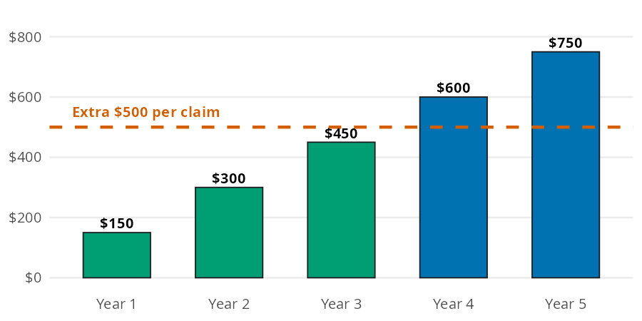
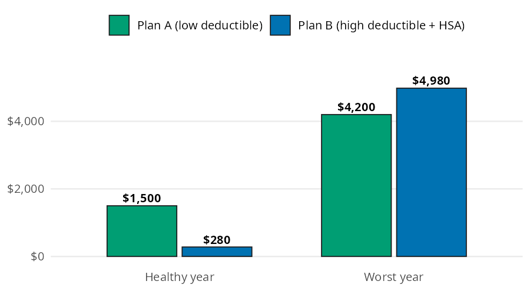

# Insurance

Insurance math helps with two everyday choices. Which deductible should you pick, and which health plan costs less over a year? The [Insurance](https://mjfrigaard.github.io/fm-finance/insurance.html) chapter of the book answers both with a little arithmetic. In this page I'll answer the same questions with [break_even_years()](../reference/break_even_years.md#perfinpy.break_even_years) and [plan_cost()](../reference/plan_cost.md#perfinpy.plan_cost), using the chapter's numbers so you can check every result against the book.


# The insurance functions

Both functions accept arrays, so one call can compare several deductibles or several kinds of years.

| Function | Returns | Units |
|----|----|----|
| [break_even_years()](../reference/break_even_years.md#perfinpy.break_even_years) | years of premium savings needed to cover a higher deductible | years, not rounded |
| [plan_cost()](../reference/plan_cost.md#perfinpy.plan_cost) | the yearly cost of a health plan | dollars per year |


# Which deductible should you pick?

The chapter's car insurance costs \$1,500 a year with a \$500 deductible, or \$1,350 a year with a \$1,000 deductible. The higher deductible saves \$150 a year, but you pay \$500 more each time you file a claim.

Each bar below is the savings piling up year after year. The dashed line is the extra \$500 you'd pay on a claim:


<figure class="figure">
<p></p>
<figcaption>Savings from a $1,000 deductible vs. a $500 deductible, year by year</figcaption>
</figure>


[break_even_years()](../reference/break_even_years.md#perfinpy.break_even_years) divides the gap between the deductibles by the yearly savings:


``` python
years = break_even_years(high_deductible=1000, low_deductible=500, yearly_savings=150)
years
```


    3.3333333333333335


The savings cover the extra deductible after about 3.3 years. If you go longer than that between claims, the higher deductible comes out ahead. Most drivers go much longer, but pick it only if your emergency fund can cover the \$1,000.


# Which health plan costs less?

Your job offers two plans. Plan A has a \$100 monthly premium and a \$3,000 out of pocket maximum. Plan B is a high deductible plan with a \$40 monthly premium, a \$5,000 out of pocket maximum, and \$500 a year from your employer into your HSA. We'll compare a healthy year (about \$300 of care) with the worst year possible.


<figure class="figure">
<p></p>
<figcaption>Total yearly cost of two health plans in a healthy year and the worst year</figcaption>
</figure>


Each bar is twelve premiums, plus your medical bills up to the out of pocket maximum, minus the employer's HSA money. [plan_cost()](../reference/plan_cost.md#perfinpy.plan_cost) takes `float("inf")` for `medical_cost` to get the worst year, because the bills are then capped at the maximum:


``` python
costs = [300, float("inf")]
plan_a = plan_cost(monthly_premium=100, medical_cost=costs, oop_max=3000)
plan_b = plan_cost(monthly_premium=40, medical_cost=costs, oop_max=5000, employer_hsa=500)
pl.DataFrame({"year": ["healthy", "worst"], "plan_a": plan_a, "plan_b": plan_b})
```


shape: (2, 3)

| year      | plan_a | plan_b |
|-----------|--------|--------|
| str       | f64    | f64    |
| "healthy" | 1500.0 | 280.0  |
| "worst"   | 4200.0 | 4980.0 |


Plan B saves \$1,220 in a healthy year and costs \$780 more in the worst year. The worst year is the ceiling on what each plan can cost you.


# Variations

The deductible decision depends on how much the higher deductible saves. Passing several values to `yearly_savings` shows how fast each one breaks even:


``` python
savings = [100, 150, 250]
pl.DataFrame({
    "yearly_savings": savings,
    "years": break_even_years(high_deductible=1000, low_deductible=500, yearly_savings=savings),
})
```


shape: (3, 2)

| yearly_savings | years    |
|----------------|----------|
| i64            | f64      |
| 100            | 5.0      |
| 150            | 3.333333 |
| 250            | 2.0      |


The bigger the yearly savings, the sooner the higher deductible pays off.


## Health plans across many kinds of year

Most years fall somewhere between healthy and worst. One call per plan covers a range of medical bills:


``` python
bills = [0.0, 300.0, 1000.0, 2500.0, 5000.0, float("inf")]
pl.DataFrame({
    "medical_cost": bills,
    "plan_a": plan_cost(monthly_premium=100, medical_cost=bills, oop_max=3000),
    "plan_b": plan_cost(monthly_premium=40, medical_cost=bills, oop_max=5000, employer_hsa=500),
})
```


shape: (6, 3)

| medical_cost | plan_a | plan_b |
|--------------|--------|--------|
| f64          | f64    | f64    |
| 0.0          | 1200.0 | -20.0  |
| 300.0        | 1500.0 | 280.0  |
| 1000.0       | 2200.0 | 980.0  |
| 2500.0       | 3700.0 | 2480.0 |
| 5000.0       | 4200.0 | 4980.0 |
| inf          | 4200.0 | 4980.0 |


With no medical bills at all, Plan B's cost is negative: the employer's \$500 is more than the \$480 of premiums. Plan B stays cheaper until the bills pass about \$4,220. Past that point Plan A has hit its maximum, and it comes out ahead.

> **Warning: Limits**
>
> Both functions use the simple version of the math in the chapter. A few limits apply:
>
> - [plan_cost()](../reference/plan_cost.md#perfinpy.plan_cost) assumes you pay every medical bill up to the out of pocket maximum. For plans with coinsurance, it slightly overstates the cost.
> - [plan_cost()](../reference/plan_cost.md#perfinpy.plan_cost) ignores copays, tax savings from HSA contributions, and what HSA money could earn if invested.
> - [break_even_years()](../reference/break_even_years.md#perfinpy.break_even_years) assumes the premium savings are the same every year and ignores premium increases after a claim.
> - [break_even_years()](../reference/break_even_years.md#perfinpy.break_even_years) raises a `ValueError` when `yearly_savings` is zero or negative. Text raises a `TypeError`, and `nan` raises a `ValueError` in either function.


# Putting it together

The chapter suggests putting Plan B's healthy year savings into the HSA. How many healthy years does it take for those savings to cover Plan B's extra cost in a worst year? The structure is the same as the deductible question: a gap divided by savings per year. That means [break_even_years()](../reference/break_even_years.md#perfinpy.break_even_years) answers it too:


``` python
cushion = break_even_years(
    high_deductible=plan_b[1],
    low_deductible=plan_a[1],
    yearly_savings=plan_a[0] - plan_b[0],
)
cushion
```


    0.639344262295082


The savings cover the worst year gap in 0.64 years, so a single healthy year is enough. After that, a bad year on Plan B still leaves you ahead of Plan A overall. The same rule as the deductible applies: have an emergency fund that covers the \$5,000 maximum first (see [Emergency Fund](emergency-fund.md)).


# Recap

Insurance choices trade a known cost now for a possible cost later. [break_even_years()](../reference/break_even_years.md#perfinpy.break_even_years) shows how long the premium savings take to cover a higher deductible. [plan_cost()](../reference/plan_cost.md#perfinpy.plan_cost) puts two health plans on the same yearly scale, from a healthy year to the worst one.

- [Insurance](https://mjfrigaard.github.io/fm-finance/insurance.html) in Personal Finance: a field manual
- Reference: [break_even_years()](../reference/break_even_years.md#perfinpy.break_even_years), [plan_cost()](../reference/plan_cost.md#perfinpy.plan_cost)
- Next: [Financial Goals](financial-goals.md)
