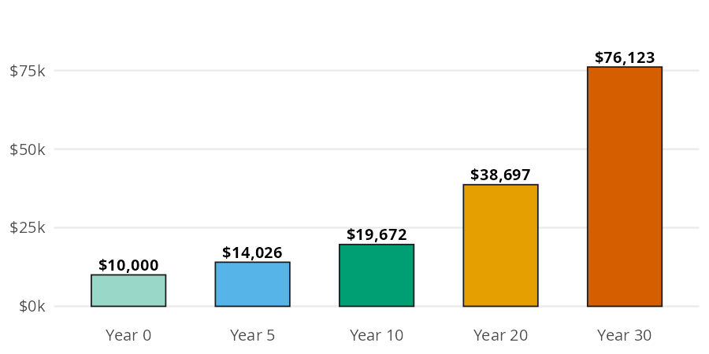
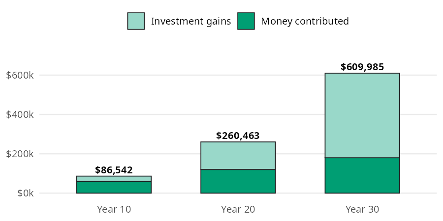
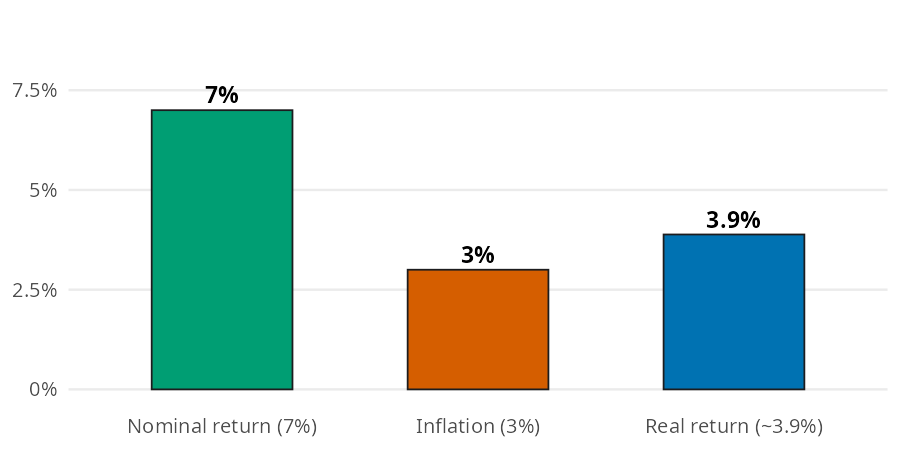

# Investing Basics

Investing math is mostly one idea (compounding) applied a few different ways. You want to know what money invested today grows into, how long it takes to double, and what a monthly habit adds up to. You also want to know how much of a return is left once inflation takes its share. In this page I'll answer those questions with [future_value()](../reference/future_value.md#perfinpy.future_value), [rule_of_72()](../reference/rule_of_72.md#perfinpy.rule_of_72), [future_value_series()](../reference/future_value_series.md#perfinpy.future_value_series), and [real_return()](../reference/real_return.md#perfinpy.real_return). The numbers come from the [Investing Basics](https://mjfrigaard.github.io/fm-finance/investing_basics.html) chapter of the book, so you can check every result against it.


# The investing basics functions

All four functions accept arrays and follow the conventions in [Get started](get-started.md). Rates are decimals, with one exception: [rule_of_72()](../reference/rule_of_72.md#perfinpy.rule_of_72) takes a percent.

| Function | Returns | Units |
|----|----|----|
| [future_value()](../reference/future_value.md#perfinpy.future_value) | what a single amount grows to | dollars (`rate` is a decimal) |
| [rule_of_72()](../reference/rule_of_72.md#perfinpy.rule_of_72) | years for money to double | years (`annual_return_pct` is a percent) |
| [future_value_series()](../reference/future_value_series.md#perfinpy.future_value_series) | what a regular contribution grows to | dollars (`rate` is per period) |
| [real_return()](../reference/real_return.md#perfinpy.real_return) | the return left after inflation | decimal (`0.039` is 3.9%) |


# How much does a single amount grow?

The chapter invests \$10,000 at 7% a year. Each year adds 7% to the balance, and the next year's 7% is applied to that larger balance. Interest earns interest.

Each bar below is the one before it multiplied by the same growth factor. The bars curve upward instead of climbing in a straight line:


<figure class="figure">
<p></p>
<figcaption>$10,000 growing at 7%: value at each checkpoint</figcaption>
</figure>


[future_value()](../reference/future_value.md#perfinpy.future_value) multiplies the starting amount by (1 + rate) once for every year:


``` python
fv_10 = future_value(present_value=10000, rate=0.07, years=10)
fv_10
```


    19671.513572895663


After 10 years, \$10,000 grows to \$19,671.51. That's almost exactly double, which is what the rule of 72 predicts.


## How long until money doubles?

The rule of 72 is a shortcut: divide 72 by the yearly return (as a percent) to estimate the years it takes to double. [rule_of_72()](../reference/rule_of_72.md#perfinpy.rule_of_72) is the one function in the package that takes a percent, so 7% goes in as `7`:


``` python
double_years = rule_of_72(annual_return_pct=7)
double_years
```


    10.285714285714286


At 7%, money doubles about every 10.3 years. That matches the bar model: \$10,000 at year 0 is close to \$20,000 at year 10 and close to \$40,000 at year 20.


# What do regular contributions grow to?

Most people don't invest one lump sum. They invest a fixed amount every month. The chapter's example is \$500 a month for 30 years at 7% a year.

Monthly investing builds wealth in two layers: the money you put in, and the growth on everything you've already put in. The bar model separates the two:


<figure class="figure">
<p></p>
<figcaption>$500 a month at 7%: contributed vs. gains</figcaption>
</figure>


[future_value_series()](../reference/future_value_series.md#perfinpy.future_value_series) adds up every contribution and its growth in one step. The `rate` is the rate per period, so a monthly series uses the yearly rate divided by 12, and `periods` is the number of months:


``` python
fv_series_30 = future_value_series(contribution=500, rate=0.07 / 12, periods=30 * 12)
contributed_30 = 500 * 30 * 12
fv_series_30, contributed_30
```


    (609985.4978879723, 180000)


After 30 years the account holds about \$609,985, and only \$180,000 of it is money you put in. The other \$429,985 is growth.


# What is a return worth after inflation?

A 7% return sounds good, but prices rise too. The chapter sets a 7% nominal return (the number before inflation) against 3% inflation. The real return is what's left:


<figure class="figure">
<p></p>
<figcaption>Nominal return, inflation, and real return</figcaption>
</figure>


The real return isn't a simple subtraction; it's a ratio, because both rates compound. [real_return()](../reference/real_return.md#perfinpy.real_return) divides one growth factor by the other:


``` python
real = real_return(nominal=0.07, inflation=0.03)
real
```


    0.03883495145631066


The real return is 3.88%, a little less than the 4% you'd get by subtracting. The result is a decimal, so you can pass it straight into [future_value()](../reference/future_value.md#perfinpy.future_value) or [future_value_series()](../reference/future_value_series.md#perfinpy.future_value_series) to get an answer in today's dollars.


# Variations

Array inputs answer several versions of a question in one call. Passing a few returns to [rule_of_72()](../reference/rule_of_72.md#perfinpy.rule_of_72), then growing \$10,000 for that many years with [future_value()](../reference/future_value.md#perfinpy.future_value), shows how close the shortcut gets to an exact double:


``` python
pcts = [4, 7, 10]
doubling = rule_of_72(annual_return_pct=pcts)
pl.DataFrame({
    "return_pct": pcts,
    "years_to_double": doubling,
    "value": future_value(
        present_value=10000, rate=[p / 100 for p in pcts], years=doubling
    ),
})
```


shape: (3, 3)

| return_pct | years_to_double | value        |
|------------|-----------------|--------------|
| i64        | f64             | f64          |
| 4          | 18.0            | 20258.165154 |
| 7          | 10.285714       | 20055.483751 |
| 10         | 7.2             | 19862.199199 |


Each value lands within a few hundred dollars of \$20,000, so the rule of 72 is a good shortcut for returns in this range.


## One call compares every checkpoint

Passing several horizons to `periods` reproduces each bar in the contributions bar model, with the money contributed alongside:


``` python
years = [10, 20, 30]
pl.DataFrame({
    "years": years,
    "contributed": [500 * 12 * y for y in years],
    "value": future_value_series(
        contribution=500, rate=0.07 / 12, periods=[y * 12 for y in years]
    ),
})
```


shape: (3, 3)

| years | contributed | value         |
|-------|-------------|---------------|
| i64   | i64         | f64           |
| 10    | 60000       | 86542.403717  |
| 20    | 120000      | 260463.329913 |
| 30    | 180000      | 609985.497888 |


> **Warning: Limits**
>
> These functions are for planning, not prediction. A few things they don't do:
>
> - [future_value()](../reference/future_value.md#perfinpy.future_value) and [future_value_series()](../reference/future_value_series.md#perfinpy.future_value_series) assume the same return every year. Real returns bounce around, and they ignore taxes, fund fees, and inflation unless you pass a real return.
> - [future_value_series()](../reference/future_value_series.md#perfinpy.future_value_series) assumes each contribution is made at the end of the period. The `rate` is per period, so passing a yearly rate with monthly `periods` gives a much larger (wrong) answer. A 0% rate returns the sum of the contributions.
> - [rule_of_72()](../reference/rule_of_72.md#perfinpy.rule_of_72) is an estimate, and it takes a percent (`7`, not `0.07`). A return of 0 or less raises a `ValueError`, because money that doesn't grow never doubles.
> - [real_return()](../reference/real_return.md#perfinpy.real_return) returns a decimal, not a percent.


# Putting it together

Back to the \$500 a month for 30 years. The \$609,985 from earlier is in future dollars. Passing the real return from the inflation section as the monthly rate gives the same account in today's dollars:


``` python
fv_series_today = future_value_series(
    contribution=500, rate=real_return(nominal=0.07, inflation=0.03) / 12, periods=360
)
fv_series_today
```


    339908.2068683674


In today's dollars the account is worth about \$339,908. That's less than the headline number, but it's still nearly twice the \$180,000 you put in.

Small amounts work the same way. The chapter's recap invests \$50 a month for 30 years at 7%:


``` python
small_habit = future_value_series(contribution=50, rate=0.07 / 12, periods=360)
small_habit
```


    60998.54978879723


\$50 a month becomes about \$60,999. The [Budgeting](budgeting.md) page puts a price on spending decisions with the same compounding math in [opportunity_cost()](../reference/opportunity_cost.md#perfinpy.opportunity_cost).


# Recap

Compounding is the force multiplier behind every investing decision. [future_value()](../reference/future_value.md#perfinpy.future_value) grows a single amount, [rule_of_72()](../reference/rule_of_72.md#perfinpy.rule_of_72) estimates how long it takes to double, and [future_value_series()](../reference/future_value_series.md#perfinpy.future_value_series) grows a monthly habit. [real_return()](../reference/real_return.md#perfinpy.real_return) takes inflation out of the return, so any of the others can answer in today's dollars.

- [Investing Basics](https://mjfrigaard.github.io/fm-finance/investing_basics.html) in Personal Finance: a field manual
- Reference: [future_value()](../reference/future_value.md#perfinpy.future_value), [rule_of_72()](../reference/rule_of_72.md#perfinpy.rule_of_72), [future_value_series()](../reference/future_value_series.md#perfinpy.future_value_series), [real_return()](../reference/real_return.md#perfinpy.real_return)
- Next: [Retirement Accounts](retirement-accounts.md)
