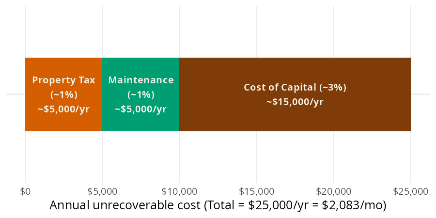
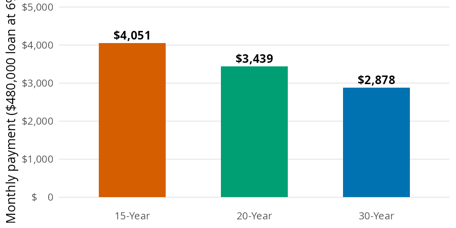
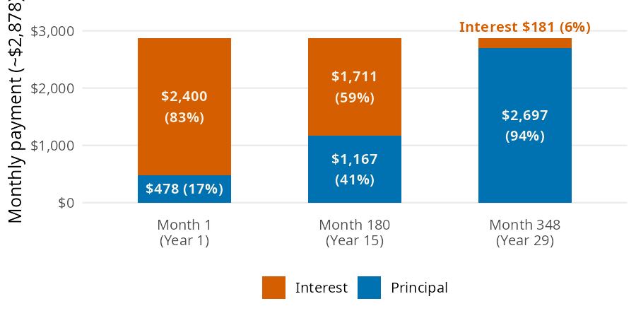

# Major Purchases

A home is the biggest purchase most people ever make, and small percentages turn into tens of thousands of dollars. The [Major Purchases](https://mjfrigaard.github.io/fm-finance/major_purchases.html) chapter of the book asks three questions: when does renting beat buying, what will the mortgage cost each month, and where does the first payment go? In this page I'll answer them with [rent_buy_threshold()](../reference/rent_buy_threshold.md#perfinpy.rent_buy_threshold), [mortgage_payment()](../reference/mortgage_payment.md#perfinpy.mortgage_payment), and [first_payment_split()](../reference/first_payment_split.md#perfinpy.first_payment_split), using the chapter's numbers so you can check each result against the book.


# The major purchase functions

[rent_buy_threshold()](../reference/rent_buy_threshold.md#perfinpy.rent_buy_threshold) and [mortgage_payment()](../reference/mortgage_payment.md#perfinpy.mortgage_payment) accept arrays. [first_payment_split()](../reference/first_payment_split.md#perfinpy.first_payment_split) takes single numbers and returns a `dict`.

| Function | Returns | Units |
|----|----|----|
| [rent_buy_threshold()](../reference/rent_buy_threshold.md#perfinpy.rent_buy_threshold) | the monthly rent that matches the unrecoverable cost of owning | dollars per month (`unrecoverable_rate` is a decimal, default `0.05`) |
| [mortgage_payment()](../reference/mortgage_payment.md#perfinpy.mortgage_payment) | the monthly payment on a fixed rate loan | dollars per month, principal and interest only |
| [first_payment_split()](../reference/first_payment_split.md#perfinpy.first_payment_split) | the interest and principal in the first payment | a `dict` of dollars, plus `pct_interest` as a percent |


# Should you rent or buy?

Owning a home costs money you never get back, whether or not you have a mortgage. The 5% rule from the chapter adds up three of those costs for a \$500,000 home: about 1% a year for property tax, 1% for maintenance, and 3% for the cost of capital (the return your money could have earned somewhere else).


<figure class="figure">
<p></p>
<figcaption>The three parts of the 5% rule on a $500,000 home</figcaption>
</figure>


[rent_buy_threshold()](../reference/rent_buy_threshold.md#perfinpy.rent_buy_threshold) takes 5% of the home's value and divides by 12:


``` python
threshold = rent_buy_threshold(home_value=500000)
threshold
```


    2083.3333333333335


Owning this home costs about \$2,083 a month that you never get back. If you can rent a similar place for less than that, renting and investing the difference tends to win.


# What will the mortgage cost each month?

The chapter's loan is \$480,000: a \$600,000 home with 20% down, at 6%. The same loan gives very different payments depending on how many months you spread it over:


<figure class="figure">
<p></p>
<figcaption>Monthly payment on a $480,000 loan at 6% across three terms</figcaption>
</figure>


[mortgage_payment()](../reference/mortgage_payment.md#perfinpy.mortgage_payment) spreads the principal plus all future interest into equal monthly payments, with the rate as a decimal:


``` python
payment = mortgage_payment(principal=480000, annual_rate=0.06, years=30)
payment
```


    2877.842520733233


The 30 year loan costs about \$2,877.84 a month. That covers principal and interest only; property tax and insurance come on top.


# Where does the first payment go?

Early mortgage payments are mostly interest. In month one the interest is the full balance times the monthly rate, and only what's left of the payment reduces the principal:


<figure class="figure">
<p></p>
<figcaption>Interest vs. principal at three points on a $480,000, 6%, 30 year mortgage</figcaption>
</figure>


[first_payment_split()](../reference/first_payment_split.md#perfinpy.first_payment_split) returns the payment, its interest and principal parts, and the interest share as a percent:


``` python
split = first_payment_split(principal=480000, annual_rate=0.06, years=30)
split
```


    {'payment': 2877.842520733233,
     'interest': 2400.0,
     'principal': 477.84252073323296,
     'pct_interest': 83.39580719616703}


Of the first \$2,878 payment, \$2,400 is interest (83%) and only \$478 reduces the loan. That's why moving after a few years leaves you with very little principal paid down.


## Call stack

[first_payment_split()](../reference/first_payment_split.md#perfinpy.first_payment_split) doesn't repeat the payment formula. It calls [mortgage_payment()](../reference/mortgage_payment.md#perfinpy.mortgage_payment), which uses the internal `_annuity_factor()` helper (the same one behind [monthly_for_goal()](../reference/monthly_for_goal.md#perfinpy.monthly_for_goal)):


``` python
from rich import print
from rich.tree import Tree

tree = Tree("first_payment_split()")
tree.add("mortgage_payment()").add("_annuity_factor()")
print(tree)
```


    first_payment_split()
    └── mortgage_payment()
        └── _annuity_factor()


# Variations

Passing several terms to `years` reproduces the three bars in the mortgage bar model. Multiplying each payment by the number of payments shows the total interest over the life of the loan:


``` python
years = [15, 20, 30]
payments = mortgage_payment(principal=480000, annual_rate=0.06, years=years)
pl.DataFrame({
    "years": years,
    "payment": payments,
    "total_interest": payments * [y * 12 for y in years] - 480000,
})
```


shape: (3, 3)

| years | payment     | total_interest |
|-------|-------------|----------------|
| i64   | f64         | f64            |
| 15    | 4050.512775 | 249092.299434  |
| 20    | 3438.869081 | 345328.579367  |
| 30    | 2877.842521 | 556023.307464  |


The 30 year loan has the lowest payment and more than twice the interest of the 15 year loan. The same approach compares rent thresholds across home prices:


``` python
home_values = [300000, 500000, 700000]
pl.DataFrame({
    "home_value": home_values,
    "threshold": rent_buy_threshold(home_value=home_values),
})
```


shape: (3, 2)

| home_value | threshold   |
|------------|-------------|
| i64        | f64         |
| 300000     | 1250.0      |
| 500000     | 2083.333333 |
| 700000     | 2916.666667 |


> **Warning: Limits**
>
> [rent_buy_threshold()](../reference/rent_buy_threshold.md#perfinpy.rent_buy_threshold) is a rule of thumb. The 5% default is an average; set `unrecoverable_rate` if your property tax or maintenance is higher or lower. It ignores home price growth, the costs of buying and selling, and how long you stay.
>
> [mortgage_payment()](../reference/mortgage_payment.md#perfinpy.mortgage_payment) assumes a fixed rate and returns principal and interest only, with no property tax, insurance, or PMI. A 0% rate returns `principal / (years * 12)`, and `years` must be greater than 0.
>
> [first_payment_split()](../reference/first_payment_split.md#perfinpy.first_payment_split) takes single numbers only. An array raises an error:
>
> <div id="split-error" class="cell" execution_count="8">
>
> ``` python
> first_payment_split(principal=480000, annual_rate=0.06, years=[15, 30])
> ```
>
> <div class="cell-output cell-output-error">
>
> <div class="ansi-escaped-output">
>
>     ---------------------------------------------------------------------------
>     ValueError                                Traceback (most recent call last)
>     Cell In[7], line 1
>     ----> 1 first_payment_split(principal=480000, annual_rate=0.06, years=[15, 30])
>
>     File ~/projects/pkgs/Python/perfinpy/src/perfinpy/major_purchases.py:147, in first_payment_split(principal, annual_rate, years)
>         145 principal = _as_scalar(principal, "principal")
>         146 annual_rate = _as_scalar(annual_rate, "annual_rate")
>     --> 147 years = _as_scalar(years, "years")
>         148 payment = float(mortgage_payment(principal, annual_rate, years))
>         149 interest = principal * (annual_rate / 12)
>
>     File ~/projects/pkgs/Python/perfinpy/src/perfinpy/_checks.py:46, in _as_scalar(x, arg)
>          44 out = _as_numeric(x, arg)
>          45 if not isinstance(out, float):
>     ---> 46     raise ValueError(f"`{arg}` must be a single number.")
>          47 return out
>
>     ValueError: `years` must be a single number.
>
> <div id="putting-it-together" class="section level1">
>
> # Putting it together
>
> The chapter's loan comes from a \$600,000 home with 20% down. That's a \$120,000 down payment, the kind of goal the [Financial Goals](financial-goals.md) page plans for. Here is the whole decision in one cell: the monthly saving for the down payment over 10 years at 4%, the rent threshold for the home, and the mortgage payment once you buy:
>
> <div id="cell-purchase-together" class="cell" execution_count="9">
>
> ``` python
> home = 600000
> save_monthly = monthly_for_goal(goal=home * 0.20, annual_rate=0.04, months=120)
> rent_line = rent_buy_threshold(home_value=home)
> mortgage = mortgage_payment(principal=home * 0.80, annual_rate=0.06, years=30)
> round(save_monthly, 2), round(rent_line, 2), round(mortgage, 2)
> ```
>
> <div id="purchase-together" class="cell-output cell-output-display" execution_count="8">
>
>     (814.94, 2500.0, 2877.84)
>
> </div>
>
> </div>
>
> Saving the down payment takes about \$815 a month for 10 years. Once you buy, the mortgage is \$2,878 a month, and the 5% rule says owning costs about \$2,500 a month that you never get back. If a comparable rental costs less than \$2,500, renting and investing the down payment is worth a serious look.
>
> <div id="recap" class="section level1">
>
> # Recap
>
> The 5% rule gives a quick rent or buy test, and [rent_buy_threshold()](../reference/rent_buy_threshold.md#perfinpy.rent_buy_threshold) turns it into a monthly number. [mortgage_payment()](../reference/mortgage_payment.md#perfinpy.mortgage_payment) shows how the term changes the payment, and [first_payment_split()](../reference/first_payment_split.md#perfinpy.first_payment_split) shows how little of an early payment goes to principal. Run these numbers before you fall in love with a floor plan.
>
> - [Major Purchases](https://mjfrigaard.github.io/fm-finance/major_purchases.html) in Personal Finance: a field manual
> - Reference: [rent_buy_threshold()](../reference/rent_buy_threshold.md#perfinpy.rent_buy_threshold), [mortgage_payment()](../reference/mortgage_payment.md#perfinpy.mortgage_payment), [first_payment_split()](../reference/first_payment_split.md#perfinpy.first_payment_split)
> - Next: [Estate Planning](estate-planning.md)
>
> </div>
>
> </div>
>
> </div>
>
> </div>
>
> </div>
