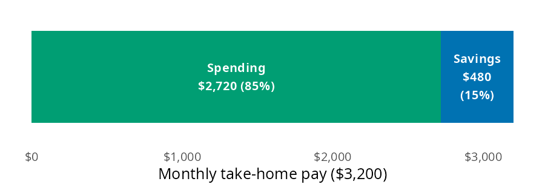
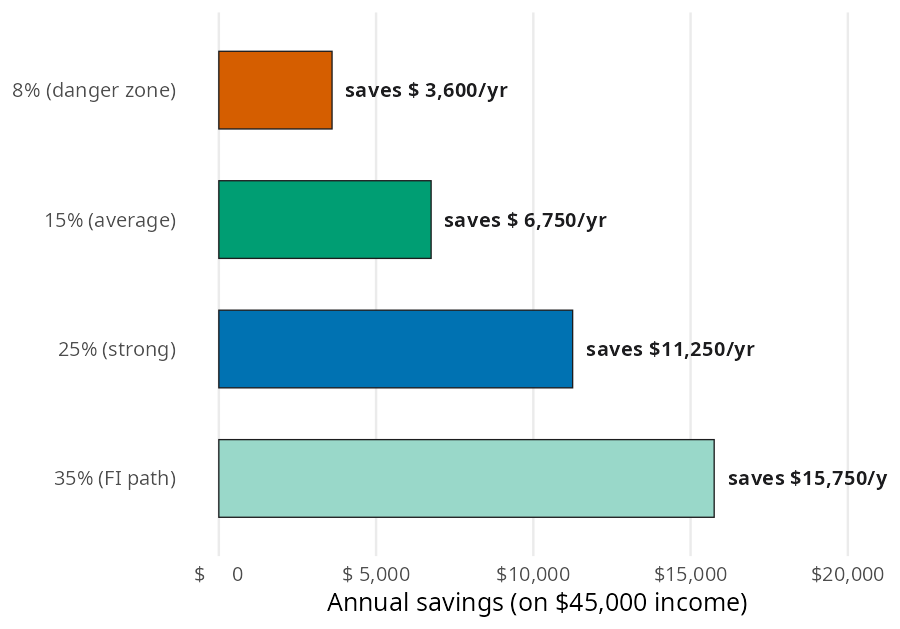

# Savings Strategies

How much of your paycheck do you actually keep? The [Savings Strategies](https://mjfrigaard.github.io/fm-finance/savings_strategies.html) chapter of the book argues that your savings rate is the one number worth tracking above all others, because it sets how fast wealth builds. In this page I'll answer that question with [savings_rate()](../reference/savings_rate.md#perfinpy.savings_rate), using the chapter's numbers so you can check every result against the book. Then we'll borrow a few functions from other chapters to follow one paycheck from savings rate to emergency fund to long term investing.


# The savings strategies function

[savings_rate()](../reference/savings_rate.md#perfinpy.savings_rate) follows the conventions on the [Get started](get-started.md) page. Like the other ratio functions, it returns a percent, not a decimal.

| Function | Returns | Units |
|----|----|----|
| [savings_rate()](../reference/savings_rate.md#perfinpy.savings_rate) | the share of income not spent | percent (`15` is 15%); negative when spending exceeds income |


# What is your savings rate?

The chapter's first job takes home \$3,200 a month and spends \$2,720 of it. Every dollar of the paycheck goes to either spending or savings, so the question is how big the savings slice is.

Think of the take home pay as one bar. Spending fills most of it, and savings is the slice left at the end:


<figure class="figure">
<p></p>
<figcaption>$3,200 take home pay: spending and savings</figcaption>
</figure>


[savings_rate()](../reference/savings_rate.md#perfinpy.savings_rate) subtracts spending from income, divides by income, and multiplies by 100:


``` python
first_job_rate = savings_rate(income=3200, spending=2720)
first_job_rate
```


    15.0


The first job saves 15% of take home pay, which lands in the chapter's average tier (10% to 20%). The result is a percent, so `15.0` means 15%. Income and spending need to cover the same period; a monthly spending total against a yearly salary gives a rate that is badly wrong.


# What do the benchmark tiers look like in dollars?

The chapter gives four benchmarks: under 10% is the danger zone, 10% to 20% is average, 20% to 30% is strong, and 30% or more is the path to financial independence. Percentages are easy to compare but hard to picture, so the chapter converts one example from each tier into dollars on a \$45,000 income:


<figure class="figure">
<p></p>
<figcaption>Annual dollars saved at four savings rate tiers on a $45,000 income</figcaption>
</figure>


Each bar is income minus spending. Because [savings_rate()](../reference/savings_rate.md#perfinpy.savings_rate) accepts arrays, one call can work backward from the dollars in each bar to the tier it belongs to:


``` python
saved = [3600, 6750, 11250, 15750]
pl.DataFrame({
    "tier": ["danger zone", "average", "strong", "FI path"],
    "saved": saved,
    "rate": savings_rate(income=45000, spending=[45000 - s for s in saved]),
})
```


shape: (4, 3)

| tier          | saved | rate |
|---------------|-------|------|
| str           | i64   | f64  |
| "danger zone" | 3600  | 8.0  |
| "average"     | 6750  | 15.0 |
| "strong"      | 11250 | 25.0 |
| "FI path"     | 15750 | 35.0 |


The rates come back as 8, 15, 25, and 35, one for each bar. Moving from the danger zone to the strong tier on the same salary means saving an extra \$7,650 a year.


# Variations

The chapter's central claim is that savings rate matters more than income. It compares someone earning \$45,000 and spending \$36,000 with someone earning \$75,000 and spending \$67,500. Passing both people to [savings_rate()](../reference/savings_rate.md#perfinpy.savings_rate) at once gives their rates:


``` python
earners = pl.DataFrame({
    "income": [45000, 75000],
    "spending": [36000, 67500],
})
earners = earners.with_columns(
    saved=pl.col("income") - pl.col("spending"),
    rate=savings_rate(income=earners["income"], spending=earners["spending"]),
)
earners
```


shape: (2, 4)

| income | spending | saved | rate |
|--------|----------|-------|------|
| i64    | i64      | i64   | f64  |
| 45000  | 36000    | 9000  | 20.0 |
| 75000  | 67500    | 7500  | 10.0 |


The lower earner saves 20% and the higher earner saves 10%. To see where each one ends up, we can borrow [future_value_series()](../reference/future_value_series.md#perfinpy.future_value_series) from [Investing Basics](investing-basics.md). It grows a yearly contribution at 7% (`rate` is a decimal per period, and here the period is a year):


``` python
years = [23, 24, 25, 26]
pl.DataFrame({
    "years": years,
    "saves_20_pct": future_value_series(contribution=9000, rate=0.07, periods=years),
    "saves_10_pct": future_value_series(contribution=7500, rate=0.07, periods=years),
})
```


shape: (4, 3)

| years | saves_20_pct  | saves_10_pct  |
|-------|---------------|---------------|
| i64   | f64           | f64           |
| 23    | 480925.268097 | 400771.056748 |
| 24    | 523590.036864 | 436325.03072  |
| 25    | 569241.339444 | 474367.78287  |
| 26    | 618088.233205 | 515073.527671 |


The \$45,000 earner crosses \$500,000 in year 24, and the \$75,000 earner crosses it in year 26. That matches the chapter's chart. The higher saver also lives on \$36,000 a year, so they need a smaller pile to stop working.

> **Warning: Limits**
>
> [savings_rate()](../reference/savings_rate.md#perfinpy.savings_rate) does one subtraction and one division, so it leaves a few things to you:
>
> - It doesn't know which income you mean. The chapter uses take home pay here, while [Automating Savings](automating-savings.md) measures the rate on gross pay because 401(k) contributions come out before taxes. The same paycheck gives a different rate on each base.
> - It doesn't check that `income` and `spending` cover the same period.
> - It returns a negative rate when spending exceeds income instead of raising an error.
> - It raises an error when `income` is zero or negative:
>
> <div id="zero-income" class="cell" execution_count="6">
>
> ``` python
> savings_rate(income=0, spending=500)
> ```
>
> <div class="cell-output cell-output-error">
>
> <div class="ansi-escaped-output">
>
>     ---------------------------------------------------------------------------
>     ValueError                                Traceback (most recent call last)
>     Cell In[6], line 1
>     ----> 1 savings_rate(income=0, spending=500)
>
>     File ~/projects/pkgs/Python/perfinpy/src/perfinpy/savings_strategies.py:42, in savings_rate(income, spending)
>          10 def savings_rate(income: ArrayLike, spending: ArrayLike) -> Numeric:
>          11     """Savings rate: the percent of income not spent.
>          12 
>          13     From the [Savings Strategies](https://mjfrigaard.github.io/fm-finance/savings_strategies.html)
>        (...)     40     15.0
>          41     """
>     ---> 42     income = _as_positive(income, "income")
>          43     spending = _as_numeric(spending, "spending")
>          44     return ((income - spending) / income) * 100
>
>     File ~/projects/pkgs/Python/perfinpy/src/perfinpy/_checks.py:38, in _as_positive(x, arg)
>          36 out = _as_numeric(x, arg)
>          37 if np.any(np.asarray(out) <= 0):
>     ---> 38     raise ValueError(f"`{arg}` must be greater than 0.")
>          39 return out
>
>     ValueError: `income` must be greater than 0.
>
> <div id="putting-it-together" class="section level1">
>
> # Putting it together
>
> Back to the first job saving \$480 a month. The chapter says savings should be protected before they grow, so the first stop is an emergency fund. The [Emergency Fund](emergency-fund.md) chapter uses \$2,400 a month in essential expenses and a four month target. [emergency_fund_target()](../reference/emergency_fund_target.md#perfinpy.emergency_fund_target) sets the goal, and [months_to_ef_goal()](../reference/months_to_ef_goal.md#perfinpy.months_to_ef_goal) counts the months to reach it at \$480 a month:
>
> <div id="cell-first-job-ef" class="cell" execution_count="7">
>
> ``` python
> monthly_saved = 3200 - 2720
> ef_target = emergency_fund_target(monthly_expenses=2400, months=4)
> ef_months = months_to_ef_goal(
>     target=ef_target, current_balance=0, monthly_contribution=monthly_saved
> )
> ef_target, ef_months
> ```
>
> <div id="first-job-ef" class="cell-output cell-output-display" execution_count="7">
>
>     (9600.0, 20)
>
> </div>
>
> </div>
>
> At a 15% savings rate, the \$9,600 fund is full in 20 months. After that, the same \$480 can go to investing instead. [future_value_series()](../reference/future_value_series.md#perfinpy.future_value_series) takes a monthly rate here, so the 7% yearly return is divided by 12:
>
> <div id="cell-first-job-invested" class="cell" execution_count="8">
>
> ``` python
> invested = future_value_series(contribution=monthly_saved, rate=0.07 / 12, periods=30 * 12)
> invested
> ```
>
> <div id="first-job-invested" class="cell-output cell-output-display" execution_count="8">
>
>     585586.0779724534
>
> </div>
>
> </div>
>
> Thirty years of \$480 a month could grow to about \$585,586. Nothing about the salary changed; the savings rate did all the work.
>
> <div id="recap" class="section level1">
>
> # Recap
>
> Your savings rate is the lever you fully control, and [savings_rate()](../reference/savings_rate.md#perfinpy.savings_rate) measures it as a percent of income. One call can check a single paycheck, place several savings amounts on the chapter's benchmark tiers, or compare people with different salaries. Paired with the emergency fund and investing functions, it shows how a modest rate turns into a protected cushion and then long term wealth.
>
> - [Savings Strategies](https://mjfrigaard.github.io/fm-finance/savings_strategies.html) in Personal Finance: a field manual
> - Reference: [savings_rate()](../reference/savings_rate.md#perfinpy.savings_rate)
> - Next: [High-Yield Savings Accounts](high-yield-accounts.md)
>
> </div>
>
> </div>
>
> </div>
>
> </div>
>
> </div>
