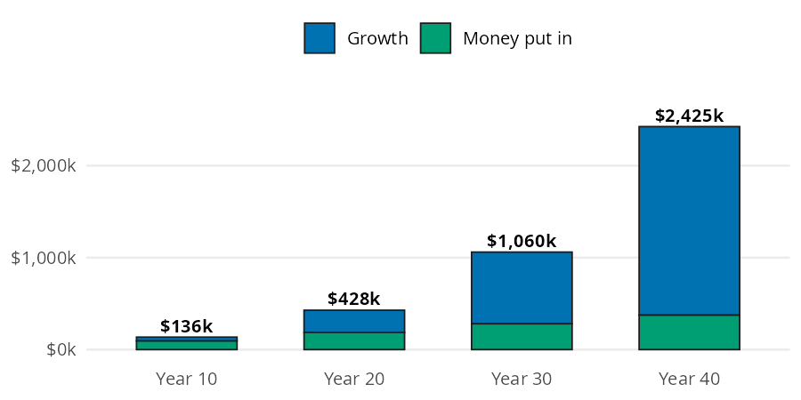
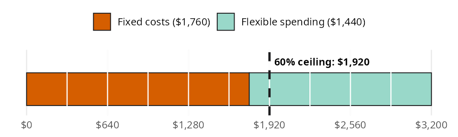
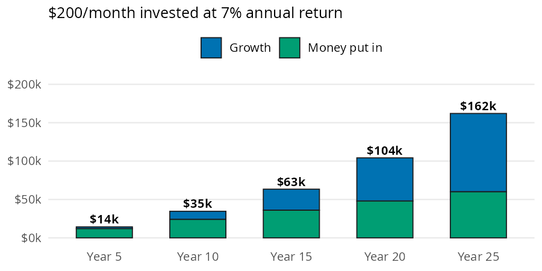

```{python}
#| label: setup
#| include: false
import polars as pl
from perfinpy import *
```

A bigger paycheck only builds wealth if some of it stays put. The book's [Income](https://mjfrigaard.github.io/fm-finance/income.html) chapter turns that idea into three questions. How much does steady saving grow into? How much of each paycheck is committed before you spend a dollar? And what is a raise worth if you invest part of it? In this page I'll answer each one with `perfinpy`, using the same numbers as the chapter.

| Function | Returns | Units |
|---|---|---|
| `wealth_formula()` | the balance after saving part of a yearly income every year | dollars; rates go in as decimals |
| `fixed_cost_ratio()` | monthly fixed costs as a share of take home pay | percent (`55`, not `0.55`) |
| `raise_invested_value()` | the balance after investing part of a monthly raise every month | dollars; rates go in as decimals |

The units follow the package conventions described in [Get started](00-get-started.qmd): rates go in as decimals and ratios come out as percents.

## How much does steady saving grow into?

The chapter builds on Scott Galloway's wealth formula (focus plus stoicism, time, and diversification multiplied together). To put numbers on it, the book uses a worker who earns about the 2025 median for full time workers. This worker saves a fixed share of income every year and invests it. The scenario below sets those inputs:

```{python}
#| label: wealth-scenario
income = 62400
save_pct = 0.15
annual_return = 0.08
wealth_years = 40
```

This worker earns \$`{python} f"{income:,}"` a year and saves `{python} f"{save_pct * 100:.0f}"`% of it, which comes to \$`{python} f"{income * save_pct:,.0f}"` a year. Those savings earn `{python} f"{annual_return * 100:.0f}"`% a year for `{python} wealth_years` years. Each bar below is the balance at a checkpoint, split into the money put in and what it grew into.

{fig-alt="Stacked bar chart of savings at years 10, 20, 30, and 40 from depositing $9,360 a year at 8%. Each bar splits into money put in (green, bottom) and growth (blue, top). The bar totals are $136k, $428k, $1,060k, and $2,425k. Growth is the smaller layer at year 10 and fills most of the bar by year 40."}

The green layer rises in a straight line because it is one deposit per year. The blue layer is every deposit growing for the years it has left, and it is the part that takes over. `wealth_formula()` adds up all of those growing deposits in one call:

```{python}
#| label: wealth-40
wealth_40 = wealth_formula(
    median_income=income,
    savings_rate=save_pct,
    annual_return=annual_return,
    years=wealth_years,
)
wealth_40
```

After `{python} wealth_years` years the balance is about \$`{python} f"{wealth_40:,.0f}"`. Only \$`{python} f"{income * save_pct * wealth_years:,.0f}"` of that is money the worker put in; the other \$`{python} f"{wealth_40 - income * save_pct * wealth_years:,.0f}"` is growth.

## How much of your paycheck is already spoken for?

Fixed costs (rent, loan payments, insurance, utilities) are the bills you can't easily change from one month to the next. The book's example is a first job with these monthly numbers:

```{python}
#| label: fixed-scenario
fixed_costs = 1760
take_home = 3200
ceiling_pct = 60
```

This paycheck brings in \$`{python} f"{take_home:,}"` of take home pay a month, and \$`{python} f"{fixed_costs:,}"` of it goes to fixed costs. The book suggests keeping fixed costs under `{python} ceiling_pct`% of take home pay, which is \$`{python} f"{take_home * ceiling_pct / 100:,.0f}"` here. The bar below cuts the paycheck into ten equal pieces and marks that ceiling.

{fig-alt="Bar model: one horizontal bar for $3,200 of take home pay, divided by white lines into ten $320 pieces. Fixed costs of $1,760 (vermillion) fill five and a half pieces, and flexible spending of $1,440 (light green) fills the rest. A dashed line marks the 60% ceiling at $1,920, just to the right of where fixed costs end."}

`fixed_cost_ratio()` divides the fixed costs by take home pay and returns a percent:

```{python}
#| label: fixed-ratio
ratio = fixed_cost_ratio(fixed_costs=fixed_costs, take_home=take_home)
ratio
```

Fixed costs take `{python} f"{ratio:g}"`% of this paycheck, under the `{python} ceiling_pct`% ceiling. That leaves \$`{python} f"{take_home * ceiling_pct / 100 - fixed_costs:,.0f}"` of room before a new commitment pushes the budget past it. The [Budgeting](03-budgeting.qmd) page picks up from here and splits the flexible part of the paycheck.

## What is a raise really worth?

The chapter recommends splitting every raise: half goes to your lifestyle and half gets invested. The book's raise adds a fixed amount to monthly take home pay:

```{python}
#| label: raise-scenario
monthly_raise = 400
share = 0.5
raise_rate = 0.07
raise_years = 25
```

A raise of \$`{python} f"{monthly_raise:,}"` a month split in half sends \$`{python} f"{monthly_raise * share:,.0f}"` a month into investments. That money earns `{python} f"{raise_rate * 100:.0f}"`% a year for `{python} raise_years` years. The bars below show the balance at each checkpoint.

{fig-alt="Stacked bar chart of $200 a month invested at a 7% annual return, at years 5, 10, 15, 20, and 25. Each bar splits into money put in (green, bottom) and growth (blue, top). The bar totals are $14k, $35k, $63k, $104k, and $162k. By year 25 the growth layer is larger than the money put in."}

`raise_invested_value()` takes the whole raise and the share you invest, then compounds the contributions monthly:

```{python}
#| label: raise-value
raise_value = raise_invested_value(
    monthly_raise=monthly_raise,
    invest_share=share,
    rate=raise_rate,
    years=raise_years,
)
raise_value
```

Half of the raise grows to about \$`{python} f"{raise_value:,.0f}"`. The contributions add up to \$`{python} f"{monthly_raise * share * 12 * raise_years:,.0f}"`, so growth adds about \$`{python} f"{raise_value - monthly_raise * share * 12 * raise_years:,.0f}"`. The [Investing Basics](09-investing-basics.qmd) page returns to this future value of contributions formula with `future_value_series()`.

## Variations

Both growth functions accept arrays, so we can compare options in one call. The savings rate is the stoicism lever in Galloway's formula. The code below keeps the income, return, and horizon from the first section and changes only the share saved:

```{python}
#| label: variations-savings-rate
rates = [0.10, 0.15, 0.20]
pl.DataFrame({
    "savings_rate": rates,
    "yearly_savings": [income * r for r in rates],
    "wealth": wealth_formula(
        median_income=income,
        savings_rate=rates,
        annual_return=annual_return,
        years=wealth_years,
    ),
})
```

The same idea works for the raise. Here is the \$`{python} f"{monthly_raise:,}"` raise with a quarter, half, three quarters, and all of it invested:

```{python}
#| label: variations-raise-share
shares = [0.25, 0.50, 0.75, 1.0]
pl.DataFrame({
    "invest_share": shares,
    "per_month": [monthly_raise * s for s in shares],
    "value": raise_invested_value(
        monthly_raise=monthly_raise,
        invest_share=shares,
        rate=raise_rate,
        years=raise_years,
    ),
})
```

Both tables scale in a straight line with the share saved because the return and horizon don't change. The horizon is where the curve bends, as the bar models above show.

::: {.callout-warning title="Limits"}
* `wealth_formula()` assumes one deposit at the end of every year, the same income every year (no raises), and the same return every year. It ignores taxes, fees, and inflation, so results are in future dollars.
* `raise_invested_value()` makes the same assumptions with a deposit at the end of every month and monthly compounding.
* A 0% return in either function gives the plain sum of the deposits instead of `nan`.
* `fixed_cost_ratio()` raises a `ValueError` when `take_home` is 0 or negative. It doesn't decide which bills count as fixed, and the 60% ceiling is a guideline from the book, not an argument.
* The growth functions reject text and `nan` but not negative values, so check the signs of your inputs.
:::

## Putting it together

The worker from the fixed cost section gets the \$`{python} f"{monthly_raise:,}"` raise. Investing half is the easy part; the real question is where the lifestyle half goes. If it stays flexible (dinners, trips), fixed costs don't change. If it goes to a pricier apartment, fixed costs rise by the full lifestyle half. The code below compares the fixed cost ratio before the raise and under both choices:

```{python}
#| label: together-ratio
new_take_home = take_home + monthly_raise
plans = pl.DataFrame({
    "plan": [
        "before the raise",
        "lifestyle half stays flexible",
        "lifestyle half goes to rent",
    ],
    "fixed_costs": [
        float(fixed_costs),
        float(fixed_costs),
        fixed_costs + monthly_raise * (1 - share),
    ],
    "take_home": [take_home, new_take_home, new_take_home],
})
plans = plans.with_columns(
    ratio=fixed_cost_ratio(
        fixed_costs=plans["fixed_costs"].to_numpy(),
        take_home=plans["take_home"].to_numpy(),
    )
)
plans
```

Keeping the lifestyle half flexible drops the ratio to `{python} f"{plans['ratio'][1]:.1f}"`%. Moving it into rent leaves the ratio at `{python} f"{plans['ratio'][2]:.1f}"`%, almost where it started, so the raise buys very little breathing room. This is the lifestyle inflation the chapter warns about: the upgrade becomes a permanent bill.

The invested half grows the same way in both plans. The code below values it twice: once with monthly deposits, and once with a single deposit at the end of each year. The yearly version uses `wealth_formula()`, whose `median_income` argument accepts any yearly amount:

```{python}
#| label: together-invest
monthly_value = raise_invested_value(
    monthly_raise=monthly_raise,
    invest_share=share,
    rate=raise_rate,
    years=raise_years,
)
yearly_value = wealth_formula(
    median_income=monthly_raise * 12,
    savings_rate=share,
    annual_return=raise_rate,
    years=raise_years,
)
monthly_value, yearly_value
```

The same dollars come out about \$`{python} f"{monthly_value - yearly_value:,.0f}"` ahead when they're invested every month. Each monthly deposit starts growing sooner, which is one more reason to automate the transfer the day the raise arrives.

## Recap

`wealth_formula()` and `raise_invested_value()` show how a steady deposit turns into a balance that is mostly growth. Time does more of the work than the deposits do. `fixed_cost_ratio()` tells you how much of each paycheck is committed before you spend anything, and returns a percent you can compare against the `{python} ceiling_pct`% ceiling. Together they make the chapter's advice measurable: keep fixed costs low, and invest part of every raise before your lifestyle absorbs it.

* [Income](https://mjfrigaard.github.io/fm-finance/income.html) in Personal Finance: a field manual
* Reference: `wealth_formula()`, `fixed_cost_ratio()`, `raise_invested_value()`
* Next: [Tracking Spending](02-tracking-spending.qmd)
