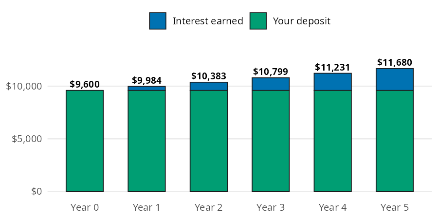

```{python}
#| label: setup
#| include: false
import polars as pl
from perfinpy import *
```

Where should your savings live, and what does that choice earn? The [High-Yield Savings Accounts](https://mjfrigaard.github.io/fm-finance/high_yield_accounts.html) chapter of the book makes the case for a high yield savings account (HYSA) at an online bank: it's insured, you can reach the money in a day or two, and it pays far more than a big bank's basic savings account. In this page I'll put numbers on that case with `hysa_balance()`, using the chapter's \$9,600 emergency fund so you can check every result against the book.

## The high yield accounts function

`hysa_balance()` follows the conventions on the [Get started](00-get-started.qmd) page: the APY goes in as a decimal, and every argument accepts arrays.

| Function | Returns | Units |
|---|---|---|
| `hysa_balance()` | the balance after growing at an APY for some years | dollars (`annual_apy` is a decimal; `years` defaults to 1) |

## How much does an emergency fund earn in a year?

The chapter follows the \$9,600 emergency fund from [Emergency Fund](05-emergency-fund.qmd) into a HYSA paying 4% APY. The APY (annual percentage yield) already includes daily compounding, so a year of growth is one multiplication by 1.04:

```{python}
#| label: one-year
one_year = hysa_balance(principal=9600, annual_apy=0.04)
one_year, one_year - 9600
```

After one year the fund holds \$`{python} f"{one_year:,.0f}"`, and \$`{python} f"{one_year - 9600:,.0f}"` of that is interest. `years` defaults to 1, so the call above doesn't need it.

## How does the balance grow year by year?

Leave the money alone and each year multiplies the previous balance by 1.04 again. The chapter draws each year as a bar split into the money you put in and the interest it has earned so far:

{fig-alt="Stacked bar chart of a $9,600 deposit at 4% APY over years 0 through 5. Each bar has the same bluish green base for the $9,600 deposit, topped by a blue layer for interest earned that grows each year. Bar totals read $9,600, $9,984, $10,383, $10,799, $11,231, and $11,680."}

The bluish green base never changes; only the blue interest layer grows. Passing several values to `years` reproduces every bar in one call:

```{python}
#| label: five-years
years = list(range(6))
balances = hysa_balance(principal=9600, annual_apy=0.04, years=years)
pl.DataFrame({
    "years": years,
    "deposit": [9600] * 6,
    "interest": balances - 9600,
    "balance": balances,
}).with_columns(pl.col("interest", "balance").round(2))
```

After five years the fund holds \$`{python} f"{balances[5]:,.2f}"`, which is the chapter's \$11,680. That's \$`{python} f"{balances[5] - 9600:,.0f}"` of growth without putting a dollar of the deposit at risk.

## Variations

The chapter compares account types rather than banks. In late 2026 the national average savings rate was 0.39%, a big bank's basic account often paid 0.01%, and the best online accounts paid 3.8% to 4.2%. `annual_apy` accepts an array, so one call compares a \$10,000 balance across all of them:

```{python}
#| label: compare-apy
apys = [0.0001, 0.0039, 0.038, 0.04, 0.042]
pl.DataFrame({
    "account": ["big bank basic", "national average", "online low", "online typical", "online high"],
    "apy": apys,
    "interest_year_1": hysa_balance(principal=10000, annual_apy=apys) - 10000,
}).with_columns(pl.col("interest_year_1").round(2))
```

The gap between online banks is small: \$40 a year separates the low and high ends on \$10,000. The gap between an online bank and a big bank's basic account is large: \$400 against \$1. As the chapter puts it, pick an online HYSA and don't overthink which one.

::: {.callout-warning title="Limits"}
`hysa_balance()` grows one lump sum at one rate, so it leaves out a few things:

* It assumes the APY never changes. Real HYSA rates move with interest rates, sometimes several times a year.
* It doesn't add deposits along the way. For a fixed monthly deposit, use `future_value_series()` from [Investing Basics](09-investing-basics.qmd).
* It ignores taxes on interest and inflation.
* It doesn't know about the \$250,000 FDIC limit per account holder per bank. Balances above that need a second bank.
* It checks that inputs are numbers, not that they make sense. A negative `annual_apy` or `years` returns a result instead of an error.
:::

## Putting it together

The chapter's two headline numbers are an APY and an emergency fund, and both come from other chapters' functions. Banks sometimes advertise an APR, the rate before compounding. `apr_to_apy()` from [Managing Debt](04-managing-debt.qmd) converts it with daily compounding, the way most HYSAs pay:

```{python}
#| label: apr-to-apy
apy = apr_to_apy(apr=0.0392)
apy
```

A 3.92% APR compounded daily is an APY of `{python} f"{apy * 100:.2f}"`%. Next, `emergency_fund_target()` from [Emergency Fund](05-emergency-fund.qmd) sets the balance to park: four months of \$2,400 in essential expenses. We can then compare that fund after five years in the HYSA and in a big bank's basic account:

```{python}
#| label: ef-in-hysa
ef_target = emergency_fund_target(monthly_expenses=2400, months=4)
in_hysa = hysa_balance(principal=ef_target, annual_apy=apy, years=5)
in_basic = hysa_balance(principal=ef_target, annual_apy=0.0001, years=5)
ef_target, round(in_hysa, 2), round(in_basic, 2)
```

The same \$`{python} f"{ef_target:,.0f}"` fund grows to \$`{python} f"{in_hysa:,.2f}"` in the HYSA and \$`{python} f"{in_basic:,.2f}"` at the big bank, a difference of \$`{python} f"{in_hysa - in_basic:,.0f}"`. Finally, `ef_growth()` from the Emergency Fund chapter does the same math in months, which helps when a goal doesn't land on a whole year:

```{python}
#| label: ef-growth
ef_growth(balance=ef_target, apy=0.04, months=[12, 18])
```

Twelve months matches `hysa_balance()` with the default one year, and 18 months shows the balance halfway through year two.

## Recap

A HYSA keeps your savings safe and reachable while paying hundreds of times what a basic account pays. `hysa_balance()` grows a balance at an APY, and passing several years or several APYs compares horizons and accounts in one call. With `apr_to_apy()`, `emergency_fund_target()`, and `ef_growth()`, it shows what an emergency fund earns while it waits.

* [High-Yield Savings Accounts](https://mjfrigaard.github.io/fm-finance/high_yield_accounts.html) in Personal Finance: a field manual
* Reference: `hysa_balance()`
* Next: [Automating Savings](08-automating-savings.qmd)
