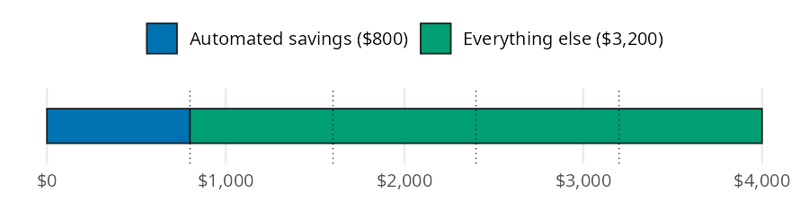

```{python}
#| label: setup
#| include: false
import polars as pl
from perfinpy import *
```

Once you know your savings rate and where the money will live, how much should leave each paycheck automatically? The [Automating Savings](https://mjfrigaard.github.io/fm-finance/automating_savings.html) chapter of the book argues for paying yourself first: savings move out before you see them, so saving no longer depends on willpower. In this page I'll answer the "how much" question with `monthly_savings()`, using the chapter's \$4,000 gross monthly pay so you can check every result against the book. Then we'll borrow functions from other chapters to follow the automated money into an emergency fund and an investment account.

## The automating savings function

`monthly_savings()` follows the conventions on the [Get started](00-get-started.qmd) page. Note the units: its `savings_rate` argument is a decimal (`0.20`), while the `savings_rate()` function from [Savings Strategies](06-savings-strategies.qmd) returns a percent (`20.0`).

| Function | Returns | Units |
|---|---|---|
| `monthly_savings()` | the monthly amount to pay yourself first | dollars per month (`savings_rate` is a decimal) |

## How much should you automate each month?

The chapter's example earns \$48,000 a year, or \$4,000 a month before taxes, and aims for a 20% savings rate. The rate is measured on gross pay here because 401(k) contributions come out before taxes.

Picture the gross paycheck as one bar cut into five equal fifths. One fifth goes to savings before you ever see it, and the rest is what you live on:

{fig-alt="Bar model: one horizontal bar for $4,000 of gross monthly pay, with dotted lines dividing it into five equal fifths. The first fifth is blue and labeled Automated savings ($800); the other four fifths are bluish green and labeled Everything else ($3,200)."}

Taking one fifth of the bar is the same as multiplying it by 0.20, which is what `monthly_savings()` does:

```{python}
#| label: pay-yourself-first
automated = monthly_savings(gross_monthly_income=4000, savings_rate=0.20)
automated
```

The paycheck sends \$`{python} f"{automated:,.0f}"` a month to savings, which leaves \$`{python} f"{4000 - automated:,.0f}"` for taxes and everything else.

## How do you split it across accounts?

In practice the 20% goes to several places at once. The chapter splits it into an emergency fund, a 401(k) contribution large enough to get a typical employer match, and sinking funds (money set aside each month for a known future bill). `savings_rate` accepts an array, so one call prices every destination:

```{python}
#| label: split
split = pl.DataFrame({
    "destination": ["emergency fund", "401(k) match", "sinking funds"],
    "rate": [0.10, 0.05, 0.05],
})
split = split.with_columns(
    amount=monthly_savings(gross_monthly_income=4000, savings_rate=split["rate"]),
)
split
```

The three amounts add up to \$`{python} f"{split['amount'].sum():,.0f}"`, the same 20% from the bar model. Payroll takes the 401(k) share before taxes, so the direct deposit split only needs to send the other \$`{python} f"{split['amount'].sum() - split['amount'][1]:,.0f}"` to the HYSA.

## Variations

The chapter's long game is escalation: raise the savings rate with each raise instead of cutting spending. Its timeline pairs a growing salary with a rate that climbs five points every two years. Dividing each salary by 12 gives the monthly income, and arrays in both arguments price every year at once. `future_value_series()` from [Investing Basics](09-investing-basics.qmd) then shows what 30 years of each monthly amount could grow to at 7% (`rate` is per month here, so the yearly return is divided by 12):

```{python}
#| label: escalation
salary = [50000, 54000, 58000, 63000]
rate = [0.15, 0.20, 0.25, 0.30]
monthly = monthly_savings(gross_monthly_income=[s / 12 for s in salary], savings_rate=rate)
pl.DataFrame({
    "year": [1, 3, 5, 7],
    "salary": salary,
    "rate": rate,
    "monthly": monthly.round(2),
    "after_30_years": future_value_series(contribution=monthly, rate=0.07 / 12, periods=30 * 12).round().astype(int),
})
```

The monthly amounts match the chapter's \$625, \$900, \$1,208, and \$1,575, and the 30 year values match its \$762k to \$1.92M range. Most of that jump is paid for by raises, not by spending less.

::: {.callout-warning title="Limits"}
`monthly_savings()` is a single multiplication, so it leaves a few things to you:

* `savings_rate` is a decimal. Passing `20` instead of `0.20` returns \$80,000, not \$800, and no error is raised.
* It doesn't check ranges. A negative income or a rate above 1 returns a result instead of an error.
* It uses whatever income you give it. The chapter uses gross pay; a rate measured on take home pay gives a smaller amount.
* It assumes a steady paycheck. For gig or commission income, the chapter suggests passing your average monthly income over the last six months.
:::

## Putting it together

Back to the \$4,000 paycheck. The emergency fund line gets \$400 a month until the fund is full. The [Emergency Fund](05-emergency-fund.qmd) chapter's first job has \$2,400 a month in essential expenses, a four month target, and \$1,200 already saved. `emergency_fund_target()` and `months_to_ef_goal()` show how long the automation takes to finish the job:

```{python}
#| label: ef-plan
ef_monthly = monthly_savings(gross_monthly_income=4000, savings_rate=0.10)
ef_target = emergency_fund_target(monthly_expenses=2400, months=4)
ef_months = months_to_ef_goal(
    target=ef_target, current_balance=1200, monthly_contribution=ef_monthly
)
ef_target, ef_months
```

The \$`{python} f"{ef_target:,.0f}"` fund is full in `{python} f"{ef_months}"` months without a single decision along the way. Once it's full, the chapter sends the \$400 to investing instead. `future_value_series()` shows what that redirected transfer could become over 30 years at 7%:

```{python}
#| label: redirect
redirected = future_value_series(contribution=ef_monthly, rate=0.07 / 12, periods=30 * 12)
redirected
```

The same \$400 transfer could grow to about \$`{python} f"{redirected:,.0f}"`. As a last check, `percent_of_income()` from [Budgeting](03-budgeting.qmd) turns the automated dollars back into a rate. It returns a percent, the reverse of the decimal `monthly_savings()` takes:

```{python}
#| label: round-trip
percent_of_income(expense=automated, income=4000)
```

## Recap

Automation makes saving the default instead of a monthly decision. `monthly_savings()` turns a savings rate into the dollar amount to automate, and its array inputs price a split across accounts or a whole escalation plan in one call. Paired with the emergency fund and investing functions, it shows where those automated dollars end up.

* [Automating Savings](https://mjfrigaard.github.io/fm-finance/automating_savings.html) in Personal Finance: a field manual
* Reference: `monthly_savings()`
* Next: [Investing Basics](09-investing-basics.qmd)
