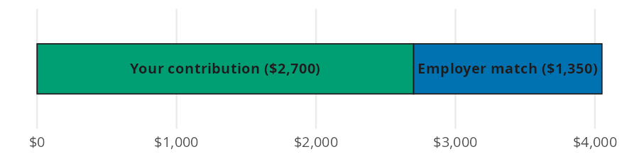
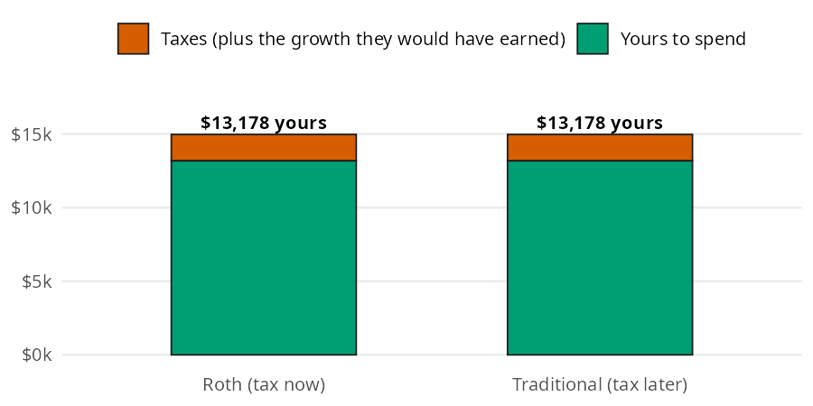

```{python}
#| label: setup
#| include: false
import polars as pl
from perfinpy import *
```

A retirement account is a container for your investments, and the container decides how they get taxed. Two questions decide most of the value. How much free money does the employer match add? And does paying tax now (Roth) or later (Traditional) leave you with more? In this page I'll answer both with `employer_match()` and `after_tax_value()`, using the numbers from the [Retirement Accounts](https://mjfrigaard.github.io/fm-finance/retirement_accounts.html) chapter of the book.

## The retirement account functions

Both functions accept arrays and follow the conventions in [Get started](00-get-started.qmd): every rate and percentage goes in as a decimal.

| Function | Returns | Units |
|---|---|---|
| `employer_match()` | what the employer adds each year | dollars per year (all percentages are decimals) |
| `after_tax_value()` | what a contribution is worth after tax and growth | dollars (`tax_rate` and `rate` are decimals) |

## How much is the employer match worth?

The chapter's example is a \$45,000 salary with a common deal: the employer matches 50% of your contributions on the first 6% of salary. If you put in 6%, the employer adds another 3%.

Think of what goes into the 401(k) as one bar. Your contribution is the first slice, and the employer adds a second, smaller slice on top:

{fig-alt="Horizontal stacked bar of yearly 401(k) deposits on a $45,000 salary, with a green slice labeled Your contribution $2,700 and a blue slice labeled Employer match $1,350. The match slice is half the length of the contribution slice, bringing the total to $4,050."}

The match slice is your contribution (up to the match limit) times the match rate. `employer_match()` takes the salary, your contribution, the match limit, and the match rate, all as decimals:

```{python}
#| label: match-6
match_6 = employer_match(
    salary=45000, contribution_pct=0.06, match_limit_pct=0.06, match_rate=0.50
)
match_6
```

Contributing 6% earns \$`{python} f"{match_6:,.0f}"` a year in free money. That's an instant 50% return on the \$2,700 you put in.

### What if you contribute less?

Many employers enroll new hires at 3%. At that rate the match slice shrinks with your contribution:

```{python}
#| label: match-3
match_3 = employer_match(
    salary=45000, contribution_pct=0.03, match_limit_pct=0.06, match_rate=0.50
)
match_3
```

At 3% the employer adds only \$`{python} f"{match_3:,.0f}"`, so the default rate leaves \$`{python} f"{match_6 - match_3:,.0f}"` a year on the table.

## Should you pay tax now or later?

Every retirement account taxes your money at some point. A Roth account taxes the contribution now, and the rest grows tax free. A Traditional account lets the whole contribution grow, and the tax comes out in retirement. The chapter sets aside \$1,000, grows it at 7% for 40 years, and uses a 12% tax rate both now and later.

{fig-alt="Stacked bar chart comparing a Roth account (tax now) and a Traditional account (tax later) for $1,000 grown at 7% for 40 years. Each bar has a large green layer labeled yours to spend and a thin vermillion layer on top for taxes plus the growth they would have earned. Both bars are the same height and both keep $13,178."}

The \$120 of Roth tax looks small today, but it would have grown along with everything else. Counted that way, the two bars are the same. Multiplying by (1 minus the tax rate) gives the same answer whether you do it first or last. `after_tax_value()` does that multiplication once and then grows the rest:

```{python}
#| label: roth-12
roth = after_tax_value(contribution=1000, tax_rate=0.12, rate=0.07, years=40)
roth
```

With a 12% rate now and later, either account leaves you about \$`{python} f"{roth:,.0f}"`. The only thing that changes the answer is a different tax rate in retirement. If that rate is 22%, the Traditional account leaves less:

```{python}
#| label: trad-22
traditional = after_tax_value(contribution=1000, tax_rate=0.22, rate=0.07, years=40)
traditional
```

The Traditional account keeps about \$`{python} f"{traditional:,.0f}"`, or \$`{python} f"{roth - traditional:,.0f}"` less than the Roth. A Roth wins when your tax rate today is lower than it will be in retirement.

## Variations

Array inputs compare several choices in one call. Here is the same \$45,000 job at four contribution rates:

```{python}
#| label: match-rates
rates = [0.0, 0.03, 0.06, 0.10]
pl.DataFrame({
    "contribution_pct": rates,
    "you_put_in": [45000 * r for r in rates],
    "employer_adds": employer_match(
        salary=45000, contribution_pct=rates, match_limit_pct=0.06, match_rate=0.50
    ),
})
```

The match stops growing at 6%. Contributing 10% still helps your retirement, but the extra 4% isn't matched.

### Which tax rate wins?

`after_tax_value()` takes several tax rates at once. Use your rate today for the Roth and your expected rate in retirement for the Traditional account:

```{python}
#| label: tax-rates
tax_rates = [0.10, 0.12, 0.22, 0.24]
pl.DataFrame({
    "tax_rate": tax_rates,
    "after_tax": after_tax_value(
        contribution=1000, tax_rate=tax_rates, rate=0.07, years=40
    ),
})
```

Find your rate now and your rate later in the table. Whichever account is taxed at the lower rate leaves you more.

::: {.callout-warning title="Limits"}
These functions cover the math in the chapter, not every plan rule:

* `employer_match()` handles a single tier match ("50% of the first 6%"). Tiered formulas such as "100% of the first 3%, then 50% of the next 2%" need one call per tier, added together.
* `employer_match()` ignores vesting, the yearly contribution limit (\$24,500 in 2026), and any match paid only at year end.
* `after_tax_value()` applies one tax rate to the whole amount. It ignores the 10% early withdrawal penalty, state taxes, and the fact that income in retirement spans several brackets.
* `after_tax_value()` assumes the same return every year and the same investments in both accounts.
:::

## Putting it together

Back to the \$45,000 job at 6%. You put in \$2,700 a year and the employer adds \$`{python} f"{match_6:,.0f}"`. Treating each year's deposits as one yearly contribution, `future_value_series()` from [Investing Basics](09-investing-basics.qmd) shows what 40 years of them grow to, and what the match alone adds:

```{python}
#| label: match-40
deposits = 2700 + match_6
total_40 = future_value_series(contribution=deposits, rate=0.07, periods=40)
match_40 = future_value_series(contribution=match_6, rate=0.07, periods=40)
total_40, match_40
```

The account grows to about \$`{python} f"{total_40:,.0f}"`, and \$`{python} f"{match_40:,.0f}"` of that comes from the match. That's the cost of skipping it.

The chapter's last warning is about cashing out an old 401(k). A \$5,000 balance cashed out at 22 loses a 12% income tax and a 10% penalty. With `rate=0` and `years=0`, `after_tax_value()` just takes out the tax, so a combined 22% gives the check you'd receive. `future_value()` shows what the same \$5,000 becomes if you leave it invested until 67:

```{python}
#| label: cash-out
cash_now = after_tax_value(contribution=5000, tax_rate=0.12 + 0.10, rate=0, years=0)
left_invested = future_value(present_value=5000, rate=0.07, years=67 - 22)
cash_now, left_invested
```

Cashing out leaves \$`{python} f"{cash_now:,.0f}"`. Leaving it invested grows it to about \$`{python} f"{left_invested:,.0f}"`, and that's before any tax in retirement.

## Recap

The employer match is part of your pay, and `employer_match()` shows how much of it you collect at each contribution rate. `after_tax_value()` shows that Roth versus Traditional comes down to one comparison: your tax rate now versus your tax rate later. Early in a career, when that rate is low, Roth is usually the better default.

* [Retirement Accounts](https://mjfrigaard.github.io/fm-finance/retirement_accounts.html) in Personal Finance: a field manual
* Reference: `employer_match()`, `after_tax_value()`
* Next: [Index Funds](11-index-funds.qmd)
