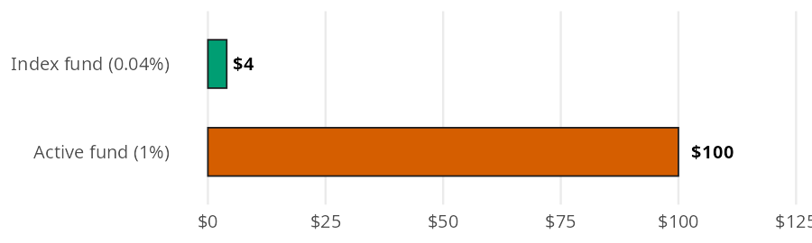
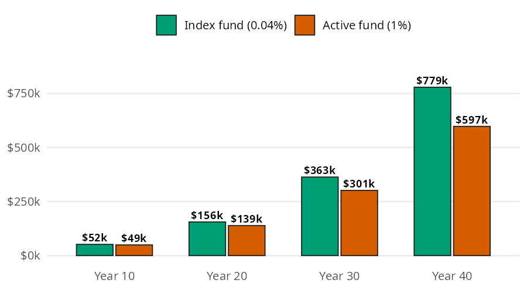

```{python}
#| label: setup
#| include: false
import polars as pl
from perfinpy import *
```

You can't control what the market does, but you can control what you pay. Index fund math is about that one thing: what fees cost you. A fee looks tiny for a single year, and it comes out every year, so each dollar it takes stops growing. In this page I'll measure both with `yearly_fee()` and `future_value_after_fees()`, using the numbers from the [Index Funds](https://mjfrigaard.github.io/fm-finance/index_funds.html) chapter of the book.

## The index fund functions

Both functions accept arrays and follow the conventions in [Get started](00-get-started.qmd). An expense ratio is a decimal, so a 0.04% fee goes in as `0.0004`.

| Function | Returns | Units |
|---|---|---|
| `yearly_fee()` | the fee a fund takes in one year | dollars (`expense_ratio` is a decimal) |
| `future_value_after_fees()` | what monthly contributions grow to after fees | dollars (`annual_return` and `expense_ratio` are decimals) |

## What does a fund charge this year?

An expense ratio is the yearly fee a fund charges, as a share of the money you have in it. The chapter puts \$10,000 in two funds: a broad index fund that charges 0.04%, and an active fund that charges 1%.

Each bar below is the slice each fund takes from the \$10,000 in one year:

{fig-alt="Horizontal bar chart of one year of fees on $10,000. The index fund (0.04%) bar is a tiny green sliver labeled $4; the active fund (1%) bar is a long vermillion bar labeled $100, 25 times as long."}

`yearly_fee()` multiplies the balance by the expense ratio. Passing both ratios at once returns both fees:

```{python}
#| label: fee-10k
fees = yearly_fee(balance=10000, expense_ratio=[0.0004, 0.01])
fees
```

The index fund charges \$`{python} f"{fees[0]:,.0f}"` a year and the active fund charges \$`{python} f"{fees[1]:,.0f}"`, `{python} f"{fees[1] / fees[0]:.0f}"` times as much. Neither number feels large, which is why the fee is easy to miss.

## What do fees cost over a lifetime?

The chapter follows someone who invests \$300 a month at a 7% return for 40 years. The two bars at each checkpoint get the same contributions and the same return; the only difference is the fee.

{fig-alt="Grouped bar chart of $300 a month invested at 7% at four checkpoints, with a green bar for the index fund (0.04%) and a vermillion bar for the active fund (1%). The pairs are $52k and $49k at year 10, $156k and $139k at year 20, $363k and $301k at year 30, and $779k and $597k at year 40. The gap between the bars widens at every checkpoint."}

The fee comes out of the return, so the math is the contribution formula from [Investing Basics](09-investing-basics.qmd) with a smaller rate. `future_value_after_fees()` subtracts the expense ratio from the return, then compounds the monthly contributions:

```{python}
#| label: fee-drag-40
index_fund = future_value_after_fees(
    contribution=300, annual_return=0.07, expense_ratio=0.0004, years=40
)
active_fund = future_value_after_fees(
    contribution=300, annual_return=0.07, expense_ratio=0.01, years=40
)
index_fund, active_fund, index_fund - active_fund
```

After 40 years the index fund grows to about \$`{python} f"{index_fund:,.0f}"` and the active fund to about \$`{python} f"{active_fund:,.0f}"`. Both investors put in the same \$`{python} f"{300 * 12 * 40:,.0f}"`. The 1% fee cost \$`{python} f"{index_fund - active_fund:,.0f}"`, about `{python} f"{(index_fund - active_fund) / index_fund * 100:.0f}"`% of what the index fund investor ended up with.

## Variations

Passing several horizons to `years` reproduces every pair of bars in the bar model in one call per fund:

```{python}
#| label: fee-drag-horizons
years = [10, 20, 30, 40]
fee_drag = pl.DataFrame({
    "years": years,
    "index_fund": future_value_after_fees(300, 0.07, 0.0004, years),
    "active_fund": future_value_after_fees(300, 0.07, 0.01, years),
}).with_columns(cost_of_fees=pl.col("index_fund") - pl.col("active_fund"))
fee_drag
```

The cost of the fee grows faster than the balances do, because the money it takes would have compounded too.

### Comparing expense ratios

The chapter suggests looking for funds under 0.10%. Passing a range of expense ratios shows what each one leaves after 40 years:

```{python}
#| label: fee-ratios
ratios = [0.0003, 0.0004, 0.001, 0.005, 0.01]
pl.DataFrame({
    "expense_ratio": ratios,
    "fee_on_10k": yearly_fee(balance=10000, expense_ratio=ratios),
    "after_40_years": future_value_after_fees(300, 0.07, ratios, 40),
})
```

The difference between 0.03% and 0.10% is small. The difference between 0.10% and 1% is not.

::: {.callout-warning title="Limits"}
A few things these functions leave out:

* `yearly_fee()` uses one balance. A fund charges its fee on your balance through the year, so a growing account pays a little more than this.
* `future_value_after_fees()` subtracts the expense ratio from the return and assumes both stay the same every year. Contributions are monthly, made at the end of each month.
* Neither function counts sales charges (loads), trading costs, advisor fees, or taxes in a taxable account.
:::

## Putting it together

The 0.04% fee looks harmless at \$4 a year, but it's charged on the balance, and the balance gets large. `yearly_fee()` shows what each fund charges in year 40, using each fund's own ending balance:

```{python}
#| label: fee-year-40
fees_40 = yearly_fee(balance=[index_fund, active_fund], expense_ratio=[0.0004, 0.01])
fees_40
```

In the last year alone, the active fund takes \$`{python} f"{fees_40[1]:,.0f}"` while the index fund takes \$`{python} f"{fees_40[0]:,.0f}"`.

With an expense ratio of 0, `future_value_after_fees()` gives the same answer as `future_value_series()` from [Investing Basics](09-investing-basics.qmd). Comparing the fee free number with the index fund shows how little a low fee costs:

```{python}
#| label: no-fee
no_fee = future_value_series(contribution=300, rate=0.07 / 12, periods=40 * 12)
no_fee, no_fee - index_fund
```

A 0.04% fee costs about \$`{python} f"{no_fee - index_fund:,.0f}"` over 40 years, compared with \$`{python} f"{index_fund - active_fund:,.0f}"` for a 1% fee.

## Recap

Fees are the one part of investing you control. `yearly_fee()` turns an expense ratio into dollars for one year, and `future_value_after_fees()` shows what that fee costs over a working lifetime. A 1% fee can cost close to a quarter of your money, so look for broad index funds that charge under 0.10%.

* [Index Funds](https://mjfrigaard.github.io/fm-finance/index_funds.html) in Personal Finance: a field manual
* Reference: `yearly_fee()`, `future_value_after_fees()`
* Next: [Asset Allocation](12-asset-allocation.qmd)
