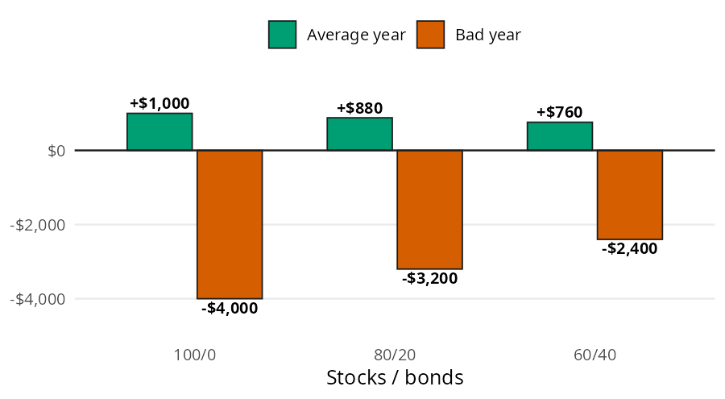
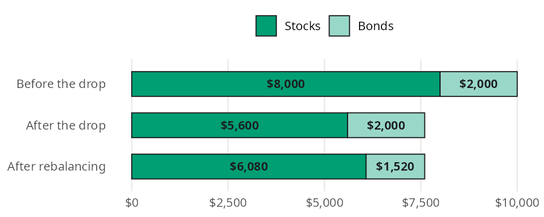

```{python}
#| label: setup
#| include: false
import polars as pl
from perfinpy import *
```

Your asset allocation is how you split your investments between stocks and bonds. It does more to decide how your money grows (and how bumpy the ride feels) than which funds you pick. Asset allocation math answers two questions. What does a split do in a good year and a bad year? And how much do you move when you rebalance? In this page I'll answer both with `portfolio_return()` and `rebalance_amount()`, using the numbers from the [Asset Allocation](https://mjfrigaard.github.io/fm-finance/asset_allocation.html) chapter of the book.

## The asset allocation functions

Both functions accept arrays and follow the conventions in [Get started](00-get-started.qmd): shares and returns are decimals. `portfolio_return()` also accepts polars expressions, so it works inside `with_columns()`.

| Function | Returns | Units |
|---|---|---|
| `portfolio_return()` | the return on a stock and bond split | decimal (`-0.32` is a 32% loss) |
| `rebalance_amount()` | how much to buy or sell to reach a target | dollars (positive buys, negative sells) |

## What does a split do in good and bad years?

The chapter splits \$10,000 three ways: 100/0, 80/20, and 60/40 (stocks/bonds). It assumes stocks earn 10% in an average year and lose 40% in a bad year. Bonds earn 4% in an average year and break even in a bad year. These are round numbers for illustration, not predictions.

{fig-alt="Bar chart of the change in $10,000 for three stock/bond splits, with a green bar for an average year and a vermillion bar for a bad year. The average year gains are $1,000 for 100/0, $880 for 80/20, and $760 for 60/40. The bad year losses are $4,000, $3,200, and $2,400. Adding bonds shrinks the gains a little and the losses a lot."}

Each bar is a weighted average: the stock return times the share in stocks, plus the bond return times the share in bonds. `portfolio_return()` takes the share in stocks and the two returns. Here is the 80/20 split in a bad year and an average year:

```{python}
#| label: mix-80-20
bad_80 = portfolio_return(stock_pct=0.80, stock_return=-0.40, bond_return=0.0)
avg_80 = portfolio_return(stock_pct=0.80, stock_return=0.10, bond_return=0.04)
bad_80, avg_80
```

In a bad year the 80/20 split loses `{python} f"{-bad_80 * 100:.0f}"`%, or \$`{python} f"{-bad_80 * 10000:,.0f}"` on \$10,000. In an average year it gains `{python} f"{avg_80 * 100:.1f}"`%, or \$`{python} f"{avg_80 * 10000:,.0f}"`. The result is a decimal, so multiply by the balance to get dollars.

## How much do you move when you rebalance?

Your split won't stay where you set it. The chapter starts with \$10,000 at 80/20 (\$8,000 in stocks and \$2,000 in bonds), then stocks drop 30%. The stock part of the bar shrinks to \$5,600, the total falls to \$7,600, and stocks are now only about 74% of it.

{fig-alt="Horizontal stacked bar chart of a portfolio at three stages, with stocks in dark green and bonds in light green. Before the drop it holds $8,000 in stocks and $2,000 in bonds. After the drop it holds $5,600 and $2,000. After rebalancing the total is still $7,600, split $6,080 in stocks and $1,520 in bonds."}

Rebalancing moves just enough from bonds to stocks to get back to 80/20. The target for stocks is 80% of the new total, and `rebalance_amount()` returns the difference between that target and what you hold:

```{python}
#| label: rebalance-stocks
move = rebalance_amount(target_pct=0.80, total=5600 + 2000, current_amount=5600)
move
```

A positive answer means buy. You move \$`{python} f"{move:,.0f}"` from bonds into stocks, which means buying stocks while they're down. That's exactly what rebalancing is for.

## Variations

The chapter's Python code builds all three splits at once with polars. Because `portfolio_return()` accepts `pl.col("stocks")`, it works inside `with_columns()` like any other expression. Multiplying by the \$10,000 balance gives the dollar labels from the bar model:

```{python}
#| label: mix-polars
pl.DataFrame({"stocks": [1.0, 0.8, 0.6]}).with_columns(
    average=portfolio_return(pl.col("stocks"), 0.10, 0.04),
    bad=portfolio_return(pl.col("stocks"), -0.40, 0.0),
).with_columns(
    average_dollars=pl.col("average") * 10000,
    bad_dollars=pl.col("bad") * 10000,
)
```

Moving from 100/0 to 60/40 gives up \$240 in an average year and saves \$1,600 in a bad one.

### Rebalancing every fund at once

`rebalance_amount()` takes arrays, so one call rebalances every fund in a portfolio. Suppose the chapter's three fund portfolio (60% US stocks, 30% international stocks, 10% bonds) has drifted to \$6,600, \$2,500, and \$900:

```{python}
#| label: rebalance-three-fund
current = [6600, 2500, 900]
pl.DataFrame({
    "fund": ["US stocks", "international stocks", "bonds"],
    "target_pct": [0.60, 0.30, 0.10],
    "current": current,
    "move": rebalance_amount(
        target_pct=[0.60, 0.30, 0.10], total=sum(current), current_amount=current
    ),
})
```

Sell \$600 of US stocks and use it to buy the other two. The moves add up to zero, because rebalancing only shifts money between funds.

::: {.callout-warning title="Limits"}
Both functions are simple on purpose:

* `portfolio_return()` covers two assets (stocks and bonds) for one year. The returns you pass are assumptions, and it ignores fees, taxes, and inflation.
* `rebalance_amount()` doesn't check that your targets add up to 100%, and `total` has to include `current_amount`.
* `rebalance_amount()` ignores trading costs and the taxes that selling can trigger in a taxable account. Inside a 401(k) or IRA, selling doesn't trigger taxes.
:::

## Putting it together

Here is the chapter's bad year from start to finish. \$10,000 at 80/20 meets a 30% stock drop, and bonds break even. `portfolio_return()` gives the loss on the whole portfolio, and `rebalance_amount()` gives the move:

```{python}
#| label: drop-and-rebalance
drop = portfolio_return(stock_pct=0.80, stock_return=-0.30, bond_return=0.0)
after_drop = 10000 * (1 + drop)
to_stocks = rebalance_amount(
    target_pct=0.80, total=after_drop, current_amount=8000 * (1 - 0.30)
)
drop, after_drop, to_stocks
```

The portfolio falls `{python} f"{-drop * 100:.0f}"`% to \$`{python} f"{after_drop:,.0f}"`, and rebalancing moves \$`{python} f"{to_stocks:,.0f}"` into stocks. How long until it's back to \$10,000? If the next years are average ones, the 80/20 split grows at `{python} f"{avg_80 * 100:.1f}"`% a year, and `future_value()` from [Investing Basics](09-investing-basics.qmd) shows the path:

```{python}
#| label: recovery
recovery_years = [1, 2, 3, 4]
pl.DataFrame({
    "years": recovery_years,
    "value": future_value(present_value=after_drop, rate=avg_80, years=recovery_years),
})
```

The portfolio is back above \$10,000 in year 4. Staying invested (and rebalancing into the drop) is what makes the recovery possible.

## Recap

Asset allocation is how you split your money between stocks and bonds, and it matters more than which funds you pick. `portfolio_return()` shows what a split does in a good year and a bad one, and it works on polars columns as well as numbers. `rebalance_amount()` shows how much to move to get back on target, which makes you buy low without predicting anything.

* [Asset Allocation](https://mjfrigaard.github.io/fm-finance/asset_allocation.html) in Personal Finance: a field manual
* Reference: `portfolio_return()`, `rebalance_amount()`
* Next: [Taxes](13-taxes.qmd)
