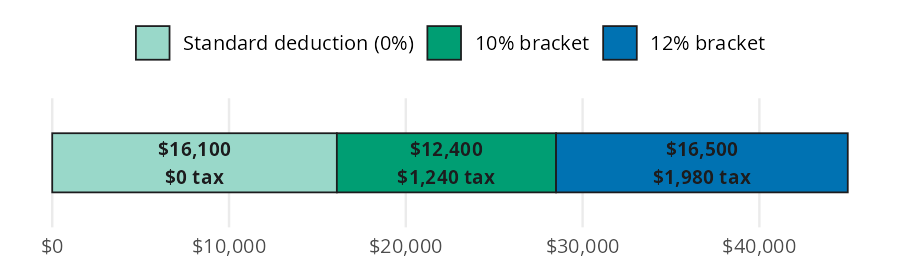
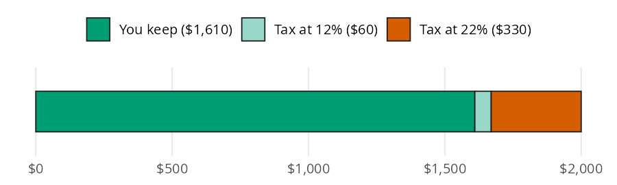

```{python}
#| label: setup
#| include: false
import polars as pl
from perfinpy import *
```

Taxes are the biggest bill most people pay, and two questions come up again and again. How much federal income tax do you owe on your salary? And how much of a raise do you keep once a higher bracket takes its share? The [Taxes](https://mjfrigaard.github.io/fm-finance/taxes.html) chapter of the book answers both by slicing income into brackets. In this page I'll answer the same questions with `income_tax()` and `raise_kept()`, using the chapter's numbers so you can check every result against the book.

## The tax functions

Both functions take single numbers only (see the conventions table in [Get started](00-get-started.qmd)). To compare several incomes, loop over them; the Variations section shows how.

| Function | Returns | Units |
|---|---|---|
| `income_tax()` | 2026 federal income tax for a single filer | dollars per year |
| `raise_kept()` | the part of a raise left after federal income tax | dollars per year |

## How much tax do you owe on a salary?

The chapter's example is a \$45,000 salary for a single filer in 2026. The question is the federal income tax bill, and what share of the salary it takes.

Think of the salary as one long bar. The first \$16,100 is covered by the standard deduction and isn't taxed. The next \$12,400 is taxed at 10%. The last \$16,500 is taxed at 12%:

{fig-alt="Stacked horizontal bar of a $45,000 salary split into three slices. A pale green slice of $16,100 for the standard deduction owes $0 tax, a bluish green slice of $12,400 in the 10% bracket owes $1,240, and a blue slice of $16,500 in the 12% bracket owes $1,980. Only the last slice is taxed at the top rate."}

`income_tax()` subtracts the deduction, multiplies each slice by its own rate, and adds up the slices:

```{python}
#| label: salary-tax
tax = income_tax(income=45000)
effective = tax / 45000
tax, effective
```

The tax is \$`{python} f"{tax:,.0f}"`, an effective rate of `{python} f"{effective * 100:.1f}"`%. That is well below 12%, the marginal rate on this salary's last dollar. The effective rate is a decimal here because we divided it ourselves; `income_tax()` returns dollars, not a rate.

## How much of a raise do you keep?

Now imagine you earn \$66,000 and get a \$2,000 raise. Taxable income goes from \$49,900 to \$51,900, which crosses the 22% line at \$50,400. The fear is that the higher bracket eats the raise.

The bar below is just the raise. The first \$500 fills the rest of the 12% bracket, and only the last \$1,500 is taxed at 22%:

{fig-alt="Stacked horizontal bar of a $2,000 raise split into three parts. A long bluish green slice labeled You keep $1,610 fills most of the bar, a thin pale green slice is $60 of tax at 12%, and a vermillion slice is $330 of tax at 22%. Most of the raise stays with you even after crossing into the higher bracket."}

`raise_kept()` takes the tax on the new income, subtracts the tax on the old income, and takes that difference out of the raise:

```{python}
#| label: raise
kept = raise_kept(old_income=66000, raise_amount=2000)
extra_tax = income_tax(income=68000) - income_tax(income=66000)
kept, extra_tax
```

You keep \$`{python} f"{kept:,.0f}"` of the \$2,000 raise, and the extra tax is \$`{python} f"{extra_tax:,.0f}"`. Crossing into a higher bracket never makes a raise cost you money; only the dollars above the line pay the higher rate.

## The call stack

`raise_kept()` doesn't have its own bracket table. It calls `income_tax()` twice, once on the new income and once on the old income, and subtracts the two results. The tree below shows that relationship:

```{python}
#| label: call-stack
#| eval: false
from rich import print
from rich.tree import Tree

tree = Tree("raise_kept()")
tree.add("income_tax(old_income + raise_amount)")
tree.add("income_tax(old_income)")
print(tree)
```

```
raise_kept()
├── income_tax(old_income + raise_amount)
└── income_tax(old_income)
```

Any change to the brackets in `income_tax()` flows straight into `raise_kept()`.

## Variations

Because both functions take single numbers, a list comprehension compares several salaries. The table below puts the tax and the effective rate side by side:

```{python}
#| label: incomes
incomes = [30000, 45000, 66000, 100000, 150000]
taxes = [income_tax(income=i) for i in incomes]
pl.DataFrame({
    "income": incomes,
    "tax": taxes,
    "effective_rate": [t / i for t, i in zip(taxes, incomes)],
})
```

The effective rate climbs with income, but it stays below each salary's top bracket. The same pattern works for raises. Here is a \$2,000 raise at each salary:

```{python}
#| label: raises
pl.DataFrame({
    "income": incomes,
    "kept": [raise_kept(old_income=i, raise_amount=2000) for i in incomes],
})
```

::: {.callout-warning title="Limits"}
`income_tax()` hard codes the 2026 federal brackets for a single filer and a \$16,100 standard deduction. A few other limits apply:

* Other years, married filers, and heads of household need different brackets, which the function doesn't take.
* You can pass a different `deduction` (for example, itemized deductions), but not different brackets.
* Neither function counts credits, FICA (7.65%), state or local taxes, or self employment tax.
* Both functions take single numbers only. A list or array raises a `ValueError`; text raises a `TypeError`.
:::

## Putting it together

Back to the \$45,000 salary. Federal income tax is only part of what comes out of the paycheck. FICA (Social Security and Medicare) takes 7.65% of every dollar, with no deduction. `percent_of_income()` from the [Budgeting](03-budgeting.qmd) page shows how much of the salary the two together claim:

```{python}
#| label: paycheck
salary = 45000
fica = salary * 0.0765
federal = income_tax(income=salary)
total = fica + federal
total_share = percent_of_income(expense=total, income=salary)
fica, federal, total_share
```

FICA takes \$`{python} f"{fica:,.2f}"` and federal income tax takes \$`{python} f"{federal:,.0f}"`. Together they claim `{python} f"{total_share:.1f}"`% of the salary, before any state tax.

Next, a \$2,000 raise on the same salary. All of it stays in the 12% bracket, so you keep a little more than in the \$66,000 example:

```{python}
#| label: raise-45k
raise_kept(old_income=salary, raise_amount=2000)
```

This number is before FICA, which takes another 7.65% of the raise.

## Recap

Tax brackets apply to slices of income, not the whole salary. `income_tax()` adds up the tax on each slice, and dividing by income gives the effective rate. `raise_kept()` calls `income_tax()` twice to show that a raise always leaves you with more money.

* [Taxes](https://mjfrigaard.github.io/fm-finance/taxes.html) in Personal Finance: a field manual
* Reference: `income_tax()`, `raise_kept()`
* Next: [Insurance](14-insurance.qmd)
