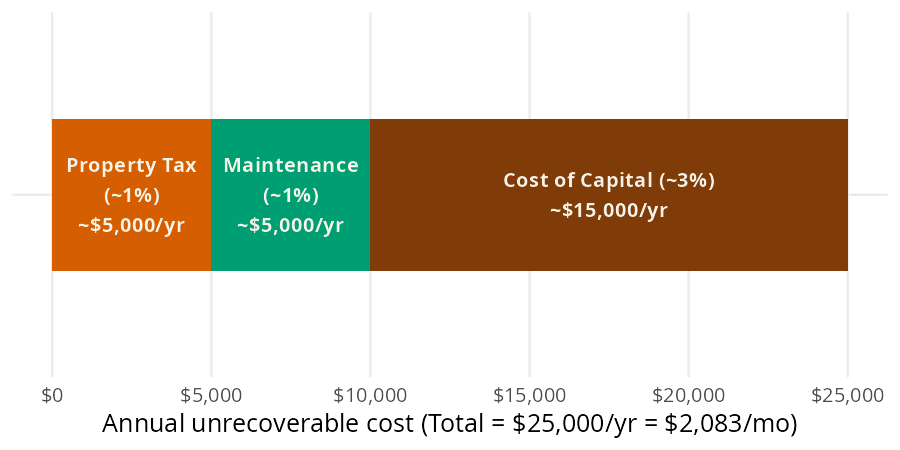
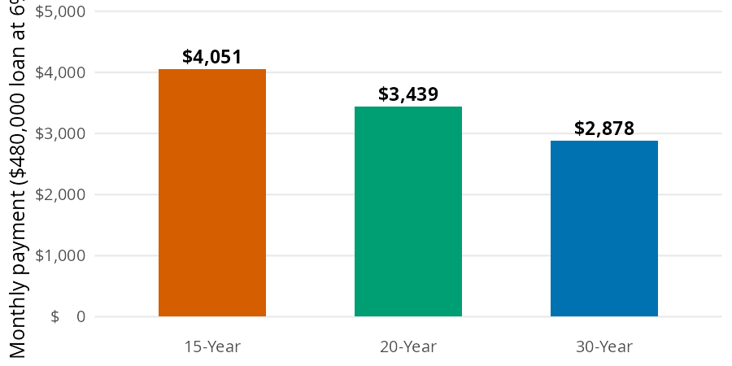
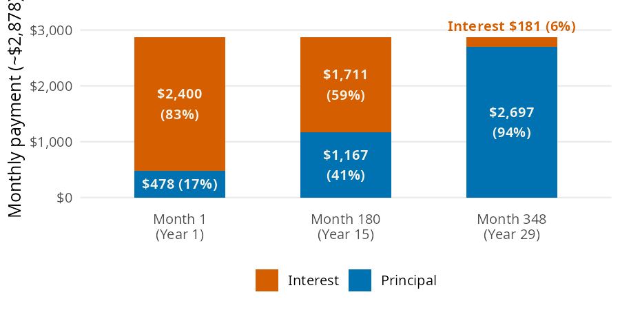

```{python}
#| label: setup
#| include: false
import polars as pl
from perfinpy import *
```

A home is the biggest purchase most people ever make, and small percentages turn into tens of thousands of dollars. The [Major Purchases](https://mjfrigaard.github.io/fm-finance/major_purchases.html) chapter of the book asks three questions: when does renting beat buying, what will the mortgage cost each month, and where does the first payment go? In this page I'll answer them with `rent_buy_threshold()`, `mortgage_payment()`, and `first_payment_split()`, using the chapter's numbers so you can check each result against the book.

## The major purchase functions

`rent_buy_threshold()` and `mortgage_payment()` accept arrays. `first_payment_split()` takes single numbers and returns a `dict`.

| Function | Returns | Units |
|---|---|---|
| `rent_buy_threshold()` | the monthly rent that matches the unrecoverable cost of owning | dollars per month (`unrecoverable_rate` is a decimal, default `0.05`) |
| `mortgage_payment()` | the monthly payment on a fixed rate loan | dollars per month, principal and interest only |
| `first_payment_split()` | the interest and principal in the first payment | a `dict` of dollars, plus `pct_interest` as a percent |

## Should you rent or buy?

Owning a home costs money you never get back, whether or not you have a mortgage. The 5% rule from the chapter adds up three of those costs for a \$500,000 home: about 1% a year for property tax, 1% for maintenance, and 3% for the cost of capital (the return your money could have earned somewhere else).

{fig-alt="Bar model: one horizontal bar of annual unrecoverable cost on a $500,000 home, split into a vermillion section for property tax (about 1%, $5,000 a year), a bluish green section for maintenance (about 1%, $5,000 a year), and a dark brown section for cost of capital (about 3%, $15,000 a year). The whole bar is $25,000 a year, or $2,083 a month, and cost of capital fills more than half of it."}

`rent_buy_threshold()` takes 5% of the home's value and divides by 12:

```{python}
#| label: rent-buy
threshold = rent_buy_threshold(home_value=500000)
threshold
```

Owning this home costs about \$`{python} f"{threshold:,.0f}"` a month that you never get back. If you can rent a similar place for less than that, renting and investing the difference tends to win.

## What will the mortgage cost each month?

The chapter's loan is \$480,000: a \$600,000 home with 20% down, at 6%. The same loan gives very different payments depending on how many months you spread it over:

{fig-alt="Bar chart of the monthly payment on a $480,000 loan at 6% for three loan terms: a vermillion bar at $4,051 for 15 years, a bluish green bar at $3,439 for 20 years, and a blue bar at $2,878 for 30 years. Shorter terms have taller bars."}

`mortgage_payment()` spreads the principal plus all future interest into equal monthly payments, with the rate as a decimal:

```{python}
#| label: mortgage
payment = mortgage_payment(principal=480000, annual_rate=0.06, years=30)
payment
```

The 30 year loan costs about \$`{python} f"{payment:,.2f}"` a month. That covers principal and interest only; property tax and insurance come on top.

## Where does the first payment go?

Early mortgage payments are mostly interest. In month one the interest is the full balance times the monthly rate, and only what's left of the payment reduces the principal:

{fig-alt="Stacked bar chart of how the same $2,878 monthly payment splits between interest (vermillion) and principal (blue) at three points in a 30 year loan. Month 1: $2,400 interest (83%) and $478 principal (17%). Month 180: $1,711 interest (59%) and $1,167 principal (41%). Month 348: $181 interest (6%) and $2,697 principal (94%). The interest share shrinks as the loan ages."}

`first_payment_split()` returns the payment, its interest and principal parts, and the interest share as a percent:

```{python}
#| label: first-payment
split = first_payment_split(principal=480000, annual_rate=0.06, years=30)
split
```

Of the first \$`{python} f"{split['payment']:,.0f}"` payment, \$`{python} f"{split['interest']:,.0f}"` is interest (`{python} f"{split['pct_interest']:.0f}"`%) and only \$`{python} f"{split['principal']:,.0f}"` reduces the loan. That's why moving after a few years leaves you with very little principal paid down.

### Call stack

`first_payment_split()` doesn't repeat the payment formula. It calls `mortgage_payment()`, which uses the internal `_annuity_factor()` helper (the same one behind `monthly_for_goal()`):

```{python}
#| label: call-stack
#| eval: false
from rich import print
from rich.tree import Tree

tree = Tree("first_payment_split()")
tree.add("mortgage_payment()").add("_annuity_factor()")
print(tree)
```

```
first_payment_split()
└── mortgage_payment()
    └── _annuity_factor()
```

## Variations

Passing several terms to `years` reproduces the three bars in the mortgage bar model. Multiplying each payment by the number of payments shows the total interest over the life of the loan:

```{python}
#| label: mortgage-terms
years = [15, 20, 30]
payments = mortgage_payment(principal=480000, annual_rate=0.06, years=years)
pl.DataFrame({
    "years": years,
    "payment": payments,
    "total_interest": payments * [y * 12 for y in years] - 480000,
})
```

The 30 year loan has the lowest payment and more than twice the interest of the 15 year loan. The same approach compares rent thresholds across home prices:

```{python}
#| label: rent-buy-prices
home_values = [300000, 500000, 700000]
pl.DataFrame({
    "home_value": home_values,
    "threshold": rent_buy_threshold(home_value=home_values),
})
```

::: {.callout-warning title="Limits"}
`rent_buy_threshold()` is a rule of thumb. The 5% default is an average; set `unrecoverable_rate` if your property tax or maintenance is higher or lower. It ignores home price growth, the costs of buying and selling, and how long you stay.

`mortgage_payment()` assumes a fixed rate and returns principal and interest only, with no property tax, insurance, or PMI. A 0% rate returns `principal / (years * 12)`, and `years` must be greater than 0.

`first_payment_split()` takes single numbers only. An array raises an error:

```{python}
#| label: split-error
#| error: true
first_payment_split(principal=480000, annual_rate=0.06, years=[15, 30])
```
:::

## Putting it together

The chapter's loan comes from a \$600,000 home with 20% down. That's a \$120,000 down payment, the kind of goal the [Financial Goals](15-financial-goals.qmd) page plans for. Here is the whole decision in one cell: the monthly saving for the down payment over 10 years at 4%, the rent threshold for the home, and the mortgage payment once you buy:

```{python}
#| label: purchase-together
home = 600000
save_monthly = monthly_for_goal(goal=home * 0.20, annual_rate=0.04, months=120)
rent_line = rent_buy_threshold(home_value=home)
mortgage = mortgage_payment(principal=home * 0.80, annual_rate=0.06, years=30)
round(save_monthly, 2), round(rent_line, 2), round(mortgage, 2)
```

Saving the down payment takes about \$`{python} f"{save_monthly:,.0f}"` a month for 10 years. Once you buy, the mortgage is \$`{python} f"{mortgage:,.0f}"` a month, and the 5% rule says owning costs about \$`{python} f"{rent_line:,.0f}"` a month that you never get back. If a comparable rental costs less than \$`{python} f"{rent_line:,.0f}"`, renting and investing the down payment is worth a serious look.

## Recap

The 5% rule gives a quick rent or buy test, and `rent_buy_threshold()` turns it into a monthly number. `mortgage_payment()` shows how the term changes the payment, and `first_payment_split()` shows how little of an early payment goes to principal. Run these numbers before you fall in love with a floor plan.

* [Major Purchases](https://mjfrigaard.github.io/fm-finance/major_purchases.html) in Personal Finance: a field manual
* Reference: `rent_buy_threshold()`, `mortgage_payment()`, `first_payment_split()`
* Next: [Estate Planning](17-estate-planning.qmd)
