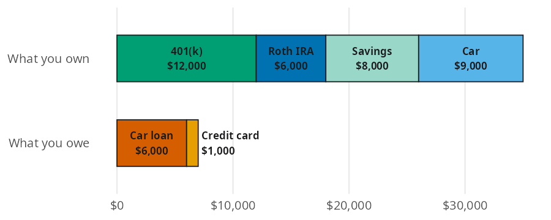
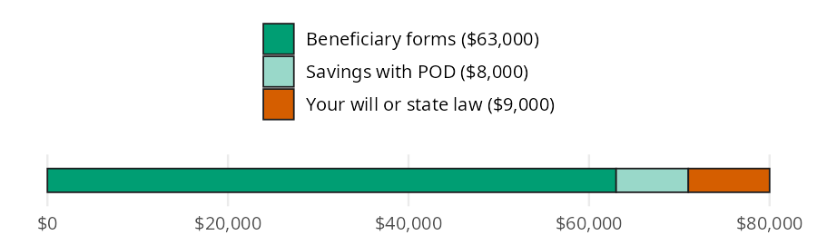

```{python}
#| label: setup
#| include: false
import polars as pl
from perfinpy import *
```

Your estate is everything you own and everything you owe. Estate planning math asks two things about it: what is it worth, and how much of it do your beneficiary forms control? In this page I'll answer both with `net_worth()` and `beneficiary_share()`, using the 25 year old from the [Estate Planning](https://mjfrigaard.github.io/fm-finance/estate_planning.html) chapter of the book so you can check each result.

## The estate functions

Both functions take a `dict` of name to amount, as the book does. A plain list of amounts works too.

| Function | Returns | Units |
|---|---|---|
| `net_worth()` | total assets minus total debts | dollars (a `float`) |
| `beneficiary_share()` | the share of assets with a named beneficiary | a decimal (`0.8875` is 88.75%) |

## What is your estate worth?

The chapter's example is a 25 year old with a 401(k), a Roth IRA, some savings, and a car. On the other side are a car loan and a small credit card balance. The bar model puts what you own on one bar and what you owe on the other:

{fig-alt="Bar model with two horizontal bars. What you own: 401(k) $12,000 in bluish green, Roth IRA $6,000 in blue, Savings $8,000 in light green, and Car $9,000 in sky blue, for $35,000 in all. What you owe: Car loan $6,000 in vermillion and Credit card $1,000 in orange, for $7,000. The owe bar is about one fifth the length of the own bar."}

Net worth is the length of the top bar minus the length of the bottom bar. `net_worth()` adds up each `dict` and subtracts:

```{python}
#| label: net-worth
assets = {"401k": 12000, "roth_ira": 6000, "savings": 8000, "car": 9000}
debts = {"car_loan": 6000, "credit_card": 1000}
worth = net_worth(assets, debts)
worth
```

The estate is worth \$`{python} f"{worth:,.0f}"`: \$`{python} f"{sum(assets.values()):,}"` in assets minus \$`{python} f"{sum(debts.values()):,}"` in debts.

## How much do your beneficiary forms control?

Now add life insurance through work. Many employers give free coverage equal to one year of salary, say \$45,000. It isn't part of net worth while you're alive, but it pays out when you die. The bar below shows everything that would pass to someone else, split by what decides who gets it:

{fig-alt="Bar model: one horizontal bar for an $80,000 estate, split into a bluish green section for beneficiary forms ($63,000), a light green section for savings with a payable on death designation ($8,000), and a vermillion section for your will or state law ($9,000). The two green sections together fill almost nine tenths of the bar."}

The green sections are decided by forms you fill out online; only the vermillion section depends on a will. `beneficiary_share()` divides the green sections by the whole bar:

```{python}
#| label: beneficiary
with_beneficiary = {
    "401k": 12000,
    "roth_ira": 6000,
    "life_insurance": 45000,
    "savings_pod": 8000,
}
without_beneficiary = {"car": 9000}
share = beneficiary_share(with_beneficiary, without_beneficiary)
share
```

About `{python} f"{share * 100:.0f}"`% of the estate is decided by forms that take minutes to fill out. That's why the book puts beneficiary designations ahead of a will for most young people. Note that the result is a decimal, not a percent.

## Variations

`beneficiary_share()` takes one estate at a time, so a list comprehension compares several. Here is the same estate with fewer forms filed:

```{python}
#| label: beneficiary-scenarios
scenarios = {
    "all forms filed": (with_beneficiary, without_beneficiary),
    "no POD on savings": (
        {"401k": 12000, "roth_ira": 6000, "life_insurance": 45000},
        {"savings": 8000, "car": 9000},
    ),
    "retirement forms only": (
        {"401k": 12000, "roth_ira": 6000},
        {"life_insurance": 45000, "savings": 8000, "car": 9000},
    ),
}
pl.DataFrame({
    "scenario": list(scenarios),
    "share": [beneficiary_share(w, wo) for w, wo in scenarios.values()],
})
```

Skipping the life insurance form costs the most, because it is the largest item. (Most employer life insurance asks for a beneficiary at enrollment; the last row shows what happens if you leave it blank.)

::: {.callout-warning title="Limits"}
`net_worth()` adds the values you give it. It doesn't know what a car is worth next year, so use today's market value, and enter debts as positive balances. It ignores taxes owed on retirement accounts and the costs of probate.

`beneficiary_share()` returns a decimal, unlike the ratio functions that return percents. It ignores joint ownership, which also passes outside a will, and it stops with a `ValueError` when total assets aren't greater than 0:

```{python}
#| label: beneficiary-error
#| error: true
beneficiary_share({}, {"car": 0})
```

Both functions raise a `TypeError` for text and a `ValueError` for missing values.
:::

## Putting it together

Estates change as you save. Five years from now, suppose the retirement accounts grow at 7% a year (with `future_value()` from [Investing Basics](09-investing-basics.qmd)), savings reach \$15,000, the car is paid off and worth \$6,000, and the credit card is cleared:

```{python}
#| label: estate-later
retirement = future_value(present_value=[12000, 6000], rate=0.07, years=5)
assets_later = {
    "401k": retirement[0],
    "roth_ira": retirement[1],
    "savings": 15000,
    "car": 6000,
}
worth_later = net_worth(assets_later, debts={"car_loan": 0, "credit_card": 0})
share_later = beneficiary_share(
    {
        "401k": retirement[0],
        "roth_ira": retirement[1],
        "life_insurance": 45000,
        "savings_pod": 15000,
    },
    {"car": 6000},
)
round(worth_later, 2), round(share_later, 4)
```

Net worth grows to \$`{python} f"{worth_later:,.0f}"`, and the forms now decide `{python} f"{share_later * 100:.0f}"`% of the estate. The bigger the accounts get, the more those ten minute forms matter.

## Recap

`net_worth()` gives the starting number for any estate plan: what you own minus what you owe. `beneficiary_share()` shows how much of that estate passes by beneficiary forms instead of a will. For most young people the answer is most of it, so fill in those forms first.

This is the last chapter of the book and the last page of the guide.

* [Estate Planning](https://mjfrigaard.github.io/fm-finance/estate_planning.html) in Personal Finance: a field manual
* Reference: `net_worth()`, `beneficiary_share()`
* Back to: [Get started](00-get-started.qmd)
